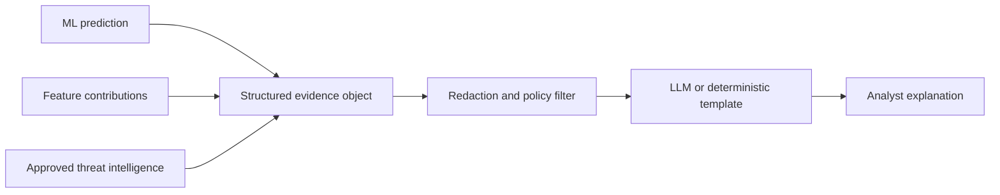

# Deployment Architecture for Cross-Network Intrusion Detection

## 1. Purpose

This document defines a deployable architecture for the project’s machine-learning intrusion-detection capability. It covers model training, real-time inference, cloud and customer-site deployment, sensitive-data restrictions, model governance, monitoring, and optional LLM-generated analyst explanations.

The recommended design is a **hybrid architecture**:

- network collection, feature extraction, and time-sensitive inference remain at the customer site;
- centralized services manage approved training, model validation, versioning, monitoring, and signed model distribution; and
- only explicitly approved, minimized telemetry leaves the customer environment.

The initial system should operate in shadow or alert-only mode. Automatic blocking should be introduced only after site-specific validation establishes an acceptable false-alarm rate.

## 2. Findings that influence the architecture

The cross-dataset experiments produced the following binary macro F1 results:

| Training strategy | 2017 test | 2018 test |
|---|---:|---:|
| 2017 only | 0.9900 | 0.6936 |
| 2018 only | 0.7945 | 0.9851 |
| Mixed, equal total budget | 0.9617 | 0.9667 |
| Mixed, expanded budget | 0.9629 | 0.9675 |

These results have several deployment implications:

1. A model can perform extremely well in its source environment while degrading substantially on another network.
2. Cross-network transfer is directional; performance cannot be assumed to transfer equally in both directions.
3. Exposure to multiple network environments improves stability.
4. The nearly identical mixed-model results indicate that environment diversity contributed more than simply increasing the number of training rows.
5. A centrally trained global model should be treated as a starting point, not as a universally calibrated detector.
6. Each customer deployment requires local shadow evaluation, threshold calibration, and drift monitoring.

The mixed model has only been tested on environments represented during its training. An independently collected third dataset or customer pilot is required before claiming generalization to an unseen network.

## 3. Architecture principles

The system should follow these principles:

- **Local-first data processing:** raw packets and identifying network metadata remain within the customer boundary by default.
- **Data minimization:** export only fields required for an approved operational or training purpose.
- **Fast deterministic detection:** the primary classifier, not an LLM, makes the real-time prediction.
- **Asynchronous explanation:** LLM explanations are generated after the alert decision and cannot delay or override enforcement.
- **Shared model with local calibration:** use a diverse global model plus site-specific thresholds and, when justified, a small local calibration layer.
- **Reproducible transformations:** package preprocessing and classification together to prevent training-serving skew.
- **Controlled learning:** analyst-confirmed outcomes may enter a governed training process; model predictions must not automatically become training labels.
- **Zero trust:** authenticate, authorize, and audit every sensor, service, user, and model artifact regardless of network location.
- **Safe degradation:** local detection continues when the cloud control plane or LLM service is unavailable.

## 4. Logical architecture

```mermaid
flowchart LR
    subgraph Customer[Customer trust boundary]
        TAP[Network TAP / NetFlow / Zeek / Suricata]
        FE[Flow assembly and feature extraction]
        VAL[Schema and quality validation]
        INF[Local ML inference]
        POLICY[Threshold and policy engine]
        SIEM[SIEM / SOC / SOAR]
        STORE[Encrypted short-term flow store]
        EXPLAIN[Optional local explanation service]

        TAP --> FE --> VAL --> INF --> POLICY --> SIEM
        FE --> STORE
        POLICY --> EXPLAIN --> SIEM
    end

    subgraph Cloud[Central control plane]
        GATE[Privacy and telemetry gateway]
        MON[Health and drift monitoring]
        LAKE[Governed training data store]
        TRAIN[Training and evaluation pipeline]
        REG[Signed model registry]
        GOV[Approval and audit workflow]

        GATE --> MON
        GATE --> LAKE
        LAKE --> TRAIN --> GOV --> REG
    end

    VAL -. approved aggregate telemetry .-> GATE
    SIEM -. approved analyst feedback .-> GATE
    REG -. signed model package .-> INF
```



## 5. Deployment modes

| Mode | Data location | Inference location | Advantages | Principal limitations | Recommended use |
|---|---|---|---|---|---|
| Cloud only | Cloud | Cloud | Centralized operations and elastic capacity | Sensitive traffic export, bandwidth, latency, and residency concerns | Cloud-native workloads with explicit telemetry authorization |
| On-premises | Customer data center | Customer data center | Strong data control and access to internal traffic | Customer-managed capacity and more complex upgrades | Regulated enterprises, healthcare, finance, and government |
| Edge | Branch, gateway, or appliance | Edge device | Lowest latency and continued operation during WAN failure | Restricted CPU, memory, storage, and observability | Branch networks, factories, and IoT gateways |
| Hybrid | Sensitive data local; governance centralized | Local or edge | Balances privacy, latency, manageability, and fleet learning | More components and policy coordination | Default recommended architecture |

The same signed model package should support on-premises, edge, and cloud-native sensors. Deployment policy determines where data may be processed and what telemetry may leave the site.

## 6. Training architecture

### 6.1 Approved data sources

The central training pipeline may use:

- public benchmark datasets;
- controlled security-test traffic;
- explicitly approved and de-identified customer samples;
- analyst-confirmed incidents;
- representative benign traffic; and
- newer independently collected environments reserved for external evaluation.

Customer predictions must not automatically become labels. This would reinforce existing errors and expose the system to feedback manipulation and poisoning.

### 6.2 Training workflow

```mermaid
flowchart LR
    A[Approved datasets] --> B[Schema mapping and validation]
    B --> C[Deduplication and quality controls]
    C --> D[Chronological and environment splits]
    D --> E[Training]
    E --> F[Offline evaluation]
    F --> G[Cross-dataset evaluation]
    G --> H[Security and privacy review]
    H --> I[Model approval]
    I --> J[Signed model registry]
```



Required controls include:

- dataset and feature lineage;
- immutable training configuration;
- environment-separated evaluation;
- time-aware validation;
- model and preprocessing versioning;
- per-dataset and per-attack-family metrics;
- privacy and licensing review;
- reproducible builds; and
- cryptographic signing before distribution.

### 6.3 Training volume

Training does not need to ingest every available flow. The experiments suggest that environmental diversity may be more valuable than simply increasing row count.

Training selection should therefore prioritize:

- multiple network types;
- representative benign behavior;
- rare attack coverage;
- temporal coverage;
- protocol and device diversity; and
- controlled sampling that prevents one large customer or class from dominating.

Maintain both an equal-environment benchmark and a full-volume operational experiment. This separates improvements caused by diversity from improvements caused by additional data.

### 6.4 Global and customer-specific components

The initial model hierarchy should be:

```text
Diverse global classifier
        +
Customer-specific probability threshold
        +
Optional site calibration layer
```

A completely separate model for every customer increases validation, upgrade, and support complexity. Site-specific thresholds and small calibration layers should be attempted before maintaining customer-specific full models.

### 6.5 Federated learning

Federated learning may be considered when customer policies prohibit exporting training records. Local sites would calculate updates and a central service would aggregate them.

It is not recommended for the first production release because:

- model updates may still leak information;
- malicious participants can poison shared training;
- customer distributions and feature availability may differ;
- secure aggregation adds operational complexity; and
- reproducing and auditing training becomes more difficult.

Federated learning should be introduced only after model governance, site identity, secure aggregation, poisoning defenses, and rollback procedures are mature.

## 7. Sensitive-data controls

### 7.1 Default boundary

The following should remain inside the customer environment unless a separate agreement explicitly authorizes export:

- raw packet payloads;
- internal IP addresses;
- hostnames and device names;
- user identifiers;
- full URLs and DNS query contents;
- credentials, tokens, or application content; and
- unredacted PCAP files.

Flow metadata can also reveal business relationships, device behavior, work schedules, and internal topology. It must be treated as sensitive even when packet payload is absent.

### 7.2 Collection tiers

| Tier | Information sent centrally | Intended purpose |
|---|---|---|
| Local only | Model version and service health | Restricted deployments |
| Aggregate telemetry | Counts, distributions, latency, drift, and alert totals | Fleet monitoring |
| De-identified flows | Approved numeric features with identifiers removed | Controlled retraining and investigation |
| Incident samples | Analyst-approved records and labels | False-positive and confirmed-attack analysis |
| Raw capture | Time-limited, separately authorized PCAP | Exceptional forensic investigation |

The customer must be able to configure or disable each tier.

### 7.3 Minimization and protection

Before data leave the site:

- remove packet payloads and unnecessary columns;
- remove or tokenize direct identifiers;
- use customer-specific rotating salts when stable pseudonyms are necessary;
- reduce timestamp precision when exact timing is unnecessary;
- validate the outbound schema against an allowlist;
- encrypt data in transit and at rest;
- enforce per-tenant isolation and retention limits; and
- record purpose, consent, access, and deletion events.

IP hashing alone should not be treated as complete anonymization because addresses can sometimes be inferred from contextual information.

## 8. Real-time inference architecture

### 8.1 Detection path

```text
Traffic sensor
    → flow assembler
    → schema validation
    → feature transformation
    → binary classifier
    → probability threshold
    → alert and response policy
    → SIEM / SOC / SOAR
```

The production artifact must include:

- required feature names and order;
- units and data types;
- missing and infinite-value policy;
- signed-log transformation;
- imputation and scaling parameters;
- model weights;
- threshold policy; and
- compatibility and version metadata.

### 8.2 Flow completion versus early detection

The current research datasets contain completed-flow statistics such as duration, total packets, and aggregate byte counts. These features become final only when a flow ends or times out.

The current model therefore supports **near-real-time flow detection**, investigation, and alert prioritization. It should not be represented as guaranteed first-packet prevention.

If subsecond blocking is required, a separate early-flow model should use features available from the first packets or first few seconds, such as:

- connection setup behavior;
- initial packet sizes;
- SYN and reset behavior;
- short-window packet rate; and
- early directional byte counts.

That model requires its own training data, latency target, evaluation, and false-blocking analysis.

### 8.3 Throughput and scaling

Logistic Regression inference is lightweight. Flow assembly, state tracking, enrichment, and alert delivery are likely to require more resources than the prediction calculation.

The runtime should:

- partition flow state by a stable connection key;
- use vectorized micro-batches where latency requirements allow;
- use bounded queues and backpressure;
- scale feature extraction independently from inference;
- provision for peak rather than average traffic;
- retain local inference during WAN outages; and
- discard optional enrichment before discarding security events.

Capacity testing must measure:

- packets and flows per second;
- end-to-end detection latency percentiles;
- flow timeout behavior;
- queue depth and dropped records;
- CPU, memory, disk, and network use;
- model inference duration; and
- SIEM delivery latency.

## 9. LLM explanation architecture

The LLM is an analyst-support component, not the detector or enforcement authority.



Only structured, policy-approved evidence should be supplied to the LLM, for example:

```json
{
  "prediction": "attack",
  "probability": 0.94,
  "important_features": [
    {"feature": "Flow Packets/s", "contribution": 0.31},
    {"feature": "SYN Flag Count", "contribution": 0.18}
  ],
  "model_version": "binary-global-3.2",
  "threat_intelligence": []
}
```

The explanation must distinguish:

- directly observed evidence;
- model predictions;
- retrieved threat-intelligence evidence;
- inferred interpretation; and
- analyst-confirmed facts.

Highly regulated deployments should support an on-premises LLM, a customer-controlled private endpoint, or deterministic templates. The primary detection path must continue if the explanation service is slow or unavailable.

## 10. Model release and deployment lifecycle

```text
Training
  → offline validation
  → cross-dataset evaluation
  → privacy and security review
  → approval
  → signed model registry
  → shadow deployment
  → canary deployment
  → limited production
  → broad deployment
```

Each release requires:

- immutable model and preprocessing versions;
- training-data lineage;
- evaluation results and known limitations;
- approval and review records;
- a signed model package;
- minimum runtime and schema compatibility;
- a rollback artifact; and
- an expiration or mandatory-review date.

The local runtime must reject unsigned, expired, incompatible, or unauthorized models.

## 11. Monitoring

### 11.1 Platform monitoring

- Sensor and extractor availability
- Schema validation failures
- Missing or malformed fields
- Flow and packet throughput
- Inference latency
- Queue backlog and dropped events
- CPU, memory, disk, and network use
- Model-loading and SIEM-delivery failures

### 11.2 Model monitoring

- Feature-distribution drift
- Prediction and confidence distributions
- Alerts per thousand flows
- Site, protocol, and device-category differences
- Confirmed false positives
- Confirmed attack recall when labels are available
- Previously unseen feature ranges
- Differences between global and locally calibrated outcomes

Drift detection should trigger investigation and controlled validation, not automatic retraining.

### 11.3 Privacy monitoring

- Outbound schema violations
- Unexpected identifiers
- Retention-policy violations
- Cross-tenant access attempts
- Export volume changes
- Consent and deletion status

## 12. Security and adversarial-ML controls

The deployed ML system is itself a target. Relevant threats include:

- inference evasion;
- training-data or feedback poisoning;
- model-package substitution;
- compromised sensors;
- feature-pipeline manipulation;
- extraction of sensitive training information;
- flow-flood denial of service; and
- prompt injection through logs or retrieved text.

Required controls include:

- mutual authentication between components;
- least-privilege workload identities;
- signed and verified model artifacts;
- encrypted transport and storage;
- tenant isolation;
- immutable audit logs;
- input validation and resource limits;
- protected analyst-feedback channels;
- independent validation before retraining; and
- rehearsed rollback and incident-response procedures.

The architecture should follow resource-centered zero-trust principles rather than trusting components solely because they are on an internal network. See [NIST SP 800-207](https://csrc.nist.gov/pubs/sp/800/207/final) and the [NIST implementation practice guide](https://csrc.nist.gov/pubs/sp/1800/35/final).

NIST also identifies evasion, poisoning, privacy, and related lifecycle threats in its [Adversarial Machine Learning taxonomy](https://www.nist.gov/publications/adversarial-machine-learning-taxonomy-and-terminology-attacks-and-mitigations).

## 13. Availability and failure behavior

The deployment must define behavior for:

- loss of connectivity to the cloud control plane;
- unavailable threat-intelligence or LLM services;
- corrupted or missing features;
- flow rates beyond rated capacity;
- model startup or verification failure;
- SIEM unavailability; and
- disk or queue exhaustion.

Recommended behavior:

- keep local deterministic detection operating during cloud outages;
- buffer alerts within bounded encrypted storage;
- disable optional enrichment when overloaded;
- fall back to the last approved model;
- expose degraded-state health signals; and
- avoid automatic blocking when required evidence or model integrity is uncertain.

## 14. Operational decisions required before production

The product owner and customer must agree on:

- alert-only versus automated blocking;
- acceptable false-alarm volume;
- maximum detection latency;
- peak throughput and availability objectives;
- data residency and retention;
- authorized telemetry tier;
- SIEM, SOAR, firewall, and ticketing integrations;
- analyst review and feedback responsibilities;
- customer opt-out and deletion procedures;
- model ownership and update cadence;
- behavior during outages; and
- incident response for a compromised sensor, model, or control plane.

Automatic blocking requires a materially higher confidence and validation standard than alert generation.

## 15. Recommended rollout

### Phase A: Engineering validation

1. Package preprocessing and the mixed Logistic Regression classifier as one signed artifact.
2. Build a replay harness using held-out PCAP or flow files.
3. Validate feature parity between notebook and runtime.
4. Measure throughput, latency, and resource consumption.

### Phase B: Controlled shadow deployment

1. Deploy to one authorized test site.
2. Keep raw packets and identifying flows local.
3. Export only health and aggregate drift telemetry.
4. Review alerts without automated enforcement.
5. Establish a site-specific threshold and alert budget.

### Phase C: Analyst workflow

1. Integrate with the customer SIEM.
2. Add feature-contribution evidence.
3. Add asynchronous grounded LLM explanations or deterministic templates.
4. Capture analyst-confirmed outcomes through an authenticated feedback channel.

### Phase D: Production hardening

1. Introduce canary releases and automated rollback.
2. Perform security, privacy, overload, and failure testing.
3. Evaluate against an unseen third network environment.
4. Add additional customers gradually and compare drift by site.

### Phase E: Advanced learning

1. Introduce controlled customer calibration.
2. Evaluate privacy-preserving aggregation.
3. Consider federated learning only after governance and poisoning defenses are mature.
4. Develop a separate early-flow model if preventive subsecond response is required.

## 16. Success criteria

Deployment success should include technical and operational measures:

| Area | Example measure |
|---|---|
| Detection | Attack recall, attack F1, and binary macro F1 on labeled evaluations |
| Operations | False alarms per thousand flows and alerts per analyst hour |
| Latency | Flow-close-to-alert latency and inference percentiles |
| Scale | Sustained and peak flows per second without loss |
| Reliability | Local operation during control-plane outage and successful rollback |
| Privacy | No unauthorized fields leaving the site and verified retention deletion |
| Generalization | Performance on an environment excluded from development |
| Explainability | Explanations grounded only in supplied model and threat evidence |
| Governance | Complete lineage, approval, audit, and version records |

Thresholds for these measures must be established with each deployment environment rather than copied from the research datasets.

## 17. Recommended target state

The target system is a **privacy-preserving hybrid intrusion-detection platform with local near-real-time inference, centralized model governance, controlled cross-customer learning, site-specific calibration, and optional grounded analyst explanations**.

This architecture directly addresses the project’s principal empirical finding: network-specific models do not transfer uniformly, while diversity improves stability. It preserves the benefits of centralized learning without requiring unrestricted collection of sensitive customer network traffic.

## References

Operational responsibilities for training, model deployment, platform reliability, and analyst feedback are defined in [`MLOPS_AIOPS_OPERATING_MODEL.md`](MLOPS_AIOPS_OPERATING_MODEL.md).

The concrete implementation stack and component alternatives are defined in [`TECHNOLOGY_COMPONENTS.md`](TECHNOLOGY_COMPONENTS.md).

- [NIST AI Risk Management Framework](https://www.nist.gov/itl/ai-risk-management-framework)
- [NIST SP 800-207: Zero Trust Architecture](https://csrc.nist.gov/pubs/sp/800/207/final)
- [NIST SP 1800-35: Implementing a Zero Trust Architecture](https://csrc.nist.gov/pubs/sp/1800/35/final)
- [NIST Adversarial Machine Learning Taxonomy](https://www.nist.gov/publications/adversarial-machine-learning-taxonomy-and-terminology-attacks-and-mitigations)
