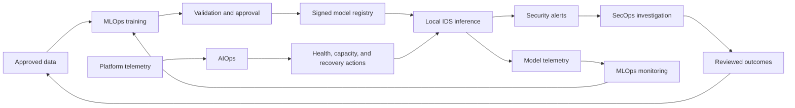
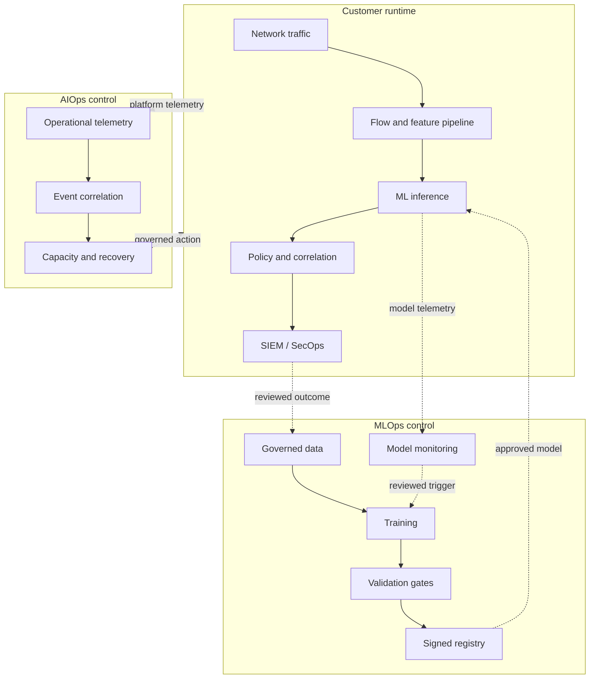

# MLOps, AIOps, and SecOps Operating Model

## 1. Purpose

This document defines how MLOps, AIOps, and SecOps support the cross-network intrusion-detection platform.

The three disciplines solve different but connected problems:

- **MLOps** governs the machine-learning lifecycle from data and experimentation through validation, deployment, monitoring, retraining, and retirement.
- **AIOps** uses analytics and automation to operate the distributed detection platform reliably and efficiently.
- **SecOps** investigates model-generated alerts, responds to threats, and supplies reviewed outcomes for future model improvement.

For this project, MLOps is the first operational priority because the current work is transitioning from research notebooks to deployable model artifacts. AIOps becomes increasingly important as the system expands across sensors, customer sites, regions, queues, model versions, and external services.

## 2. Relationship among the disciplines



The operating model contains three controlled feedback loops:

1. **Security loop:** prediction → analyst investigation → reviewed outcome.
2. **Model loop:** model behavior → drift and performance review → candidate retraining.
3. **Operations loop:** platform telemetry → AIOps analysis → capacity or recovery action.

These loops should remain distinct. Infrastructure anomalies must not become training labels, and model predictions must not automatically become operational commands without policy checks.

## 3. Why this project needs MLOps

The experiments show that models can perform very differently across network environments:

| Training strategy | 2017 macro F1 | 2018 macro F1 |
|---|---:|---:|
| 2017 only | 0.9900 | 0.6936 |
| 2018 only | 0.7945 | 0.9851 |
| Mixed, equal budget | 0.9617 | 0.9667 |
| Mixed, expanded budget | 0.9629 | 0.9675 |

These results mean model identity alone is insufficient. Production decisions also depend on:

- training environments;
- data and label versions;
- feature definitions;
- preprocessing;
- validation period;
- customer calibration;
- probability threshold; and
- deployment context.

MLOps makes those dependencies visible, reproducible, testable, and governable.

## 4. MLOps responsibilities

### 4.1 Data lineage and governance

Every training dataset should record:

- source and owner;
- collection environment;
- collection dates;
- license and permitted use;
- customer authorization where applicable;
- raw and processed locations;
- label policy;
- cleaning and deduplication rules;
- sampling strategy;
- train, validation, and test membership;
- feature-schema version;
- privacy classification; and
- retention and deletion policy.

An example dataset record is:

```text
training-set-v4
├── CICIDS2017 controlled sample
├── CSE-CIC-IDS2018 controlled sample
├── label policy: attempted attacks scored as benign
├── feature schema: common-flow-v3
├── chronological split definition: split-v2
├── sampling policy: environment-balanced-v1
└── customer data: none
```

Predictions must not automatically be stored as training labels. Doing so would reinforce model mistakes and create a data-poisoning path.

### 4.2 Feature management

The production feature pipeline must match training exactly. Version and validate:

- column names and order;
- units and data types;
- flow-direction conventions;
- flow timeout behavior;
- missing and infinite-value handling;
- signed-log transformation;
- imputation values;
- scaling parameters;
- categorical mappings; and
- required versus optional features.

Preprocessing and classification should be distributed together:

```text
model-package-v3.2
├── feature-schema.json
├── preprocessing pipeline
├── classifier
├── threshold policy
├── evaluation report
├── compatibility metadata
└── cryptographic signature
```

This prevents training-serving skew and accidental column substitution.

### 4.3 Experiment tracking

Every experiment should record:

- source-code revision;
- notebook or pipeline version;
- dataset and split versions;
- model family and parameters;
- random seed;
- training population and class distribution;
- training and prediction duration;
- software and hardware environment;
- macro F1 and per-class metrics;
- attack recall and false-alarm rate;
- results by dataset and site; and
- generated model and report artifacts.

The cross-dataset results should be represented as comparable experiments rather than isolated notebook outputs.

### 4.4 Model registry

Approved models enter a controlled registry with:

- model version;
- preprocessing and feature-schema versions;
- training-data lineage;
- evaluation results;
- intended deployment scope;
- customer restrictions;
- approval status;
- signature and checksum;
- compatible runtime versions;
- creation, review, and expiration dates; and
- rollback predecessor.

Recommended lifecycle states are:

```text
Candidate → Validated → Approved → Canary → Production → Retired
```

An experimental notebook artifact must not be deployed directly to all customer sites.

### 4.5 Validation gates

Automated checks should reject a candidate when it violates defined requirements.

Example gates include:

```text
Required environment macro F1 satisfied
Attack recall above minimum
False-alarm rate below operational limit
No material regression for protected attack families
Inference latency within deployment tier limit
Feature schema compatible
No unauthorized training data
Privacy and license review complete
Model package signed
Rollback artifact available
```

A model should not be promoted solely because its average score improves. Cross-network results show that a candidate may improve one environment and degrade another.

### 4.6 Deployment automation

MLOps supports controlled progression:

```text
Offline validation
    → replay testing
    → internal shadow deployment
    → selected customer canary
    → limited production percentage
    → broader fleet
```

The deployment service should verify:

- package signature;
- model approval status;
- runtime compatibility;
- feature-schema compatibility;
- customer authorization;
- resource requirements; and
- rollback availability.

### 4.7 Model monitoring

Monitor:

- feature distributions;
- missing and invalid features;
- unseen feature ranges;
- prediction and probability distributions;
- alert rate;
- customer and site differences;
- confirmed false positives;
- attack recall where labels become available;
- threshold changes;
- model-version disagreement; and
- differences between global and locally calibrated behavior.

Drift should trigger investigation and controlled validation, not immediate automatic retraining.

### 4.8 Reviewed feedback

Analyst feedback becomes useful only after quality control:

```text
Alert
    → analyst disposition
    → confirmed attack / false positive / uncertain
    → evidence and consistency review
    → approved training candidate
```

The feedback record should include analyst identity or role, timestamp, supporting evidence, confidence, and any later correction.

### 4.9 Retraining policy

Candidate retraining may be triggered by:

- sustained significant drift;
- verified new attacks;
- addition of a materially different environment;
- confirmed performance degradation;
- feature-schema changes; or
- a scheduled governance review.

Retraining should not occur merely because more data have accumulated.

## 5. Why this project needs AIOps

As deployment grows, the platform may contain many sensors, feature workers, inference processes, queues, model versions, customer policies, SIEM integrations, and explanation services.

AIOps helps determine:

- whether sensors and workers are healthy;
- whether queues are falling behind;
- whether latency is abnormal;
- whether a model rollout caused operational changes;
- whether an alert spike represents attacks or a broken pipeline;
- whether additional capacity is required; and
- which related technical symptoms belong to the same incident.

## 6. AIOps responsibilities

### 6.1 Platform telemetry

Collect operational signals such as:

- packets and flows per second;
- concurrent active flows;
- feature-processing throughput;
- inference rate and latency;
- queue depth and oldest-event age;
- dropped packets, flows, or alerts;
- CPU, memory, disk, and network use;
- sensor and service availability;
- schema-validation failures;
- model-loading failures;
- SIEM delivery failures;
- telemetry-export failures; and
- optional LLM latency and error rate.

### 6.2 Health anomaly detection

AIOps can learn or calculate normal operational ranges and identify abnormal combinations.

Example:

```text
Normal:
  50,000 flows/second
  p95 inference latency: 15 ms
  queue depth: below 2,000

Observed:
  48,000 flows/second
  p95 inference latency: 240 ms
  queue depth: 80,000
```

Because traffic volume did not increase materially, the most likely issue is processing degradation rather than demand growth.

### 6.3 Event correlation

AIOps correlates events across the platform.

```text
New model deployed
    + feature-validation errors increase
    + inference queue grows
    + alert rate drops unexpectedly
    ↓
Probable model and feature-schema incompatibility
```

Correlation prevents multiple teams from treating each symptom as an unrelated incident.

### 6.4 Capacity management

AIOps may recommend or initiate scaling when:

- queue depth and event age increase;
- inference latency exceeds objectives;
- active-flow state approaches memory limits;
- packet or flow drops occur; or
- a site approaches its rated capacity.

Stateless inference workers can usually scale automatically. Stateful flow workers require controlled rebalancing so active connection state is not lost.

### 6.5 Root-cause analysis

When detection behavior changes, AIOps helps distinguish among:

- an actual attack increase;
- benign customer traffic growth;
- sensor failure;
- feature-schema change;
- queue saturation;
- model regression;
- threshold modification;
- missing telemetry; and
- SIEM delivery failure.

A sudden drop in alerts is not automatically good news; it may indicate a broken sensor or incompatible model.

### 6.6 Automated remediation

Low-risk actions may be automated:

- restart a failed stateless worker;
- add inference capacity;
- redirect work to a healthy consumer;
- disable optional enrichment;
- delay low-priority LLM explanations;
- restore the last approved configuration; and
- roll back a failed canary model.

High-impact actions should normally require explicit policy approval:

- block customer traffic;
- delete evidence;
- change detection thresholds;
- retrain or promote a model;
- export additional customer data; or
- disable required security monitoring.

## 7. SecOps responsibilities

SecOps converts model output into security decisions.

Responsibilities include:

- reviewing alerts;
- correlating related suspicious flows;
- validating evidence;
- enriching incidents with approved threat intelligence;
- determining severity and priority;
- escalating confirmed threats;
- initiating response under customer policy;
- documenting outcomes; and
- supplying reviewed feedback to MLOps.

The LLM explanation service primarily supports SecOps:

```text
ML prediction
    + model feature contributions
    + approved threat intelligence
    → grounded explanation
    → analyst investigation
```

The LLM should not independently direct MLOps to retrain or AIOps to block traffic.

## 8. Integration architecture



## 9. Governance boundaries

| Action | MLOps | AIOps | SecOps | Approval expectation |
|---|---:|---:|---:|---|
| Train candidate model | Primary |  | Consulted | Usually required by workflow |
| Validate and register model | Primary |  | Consulted | Required |
| Distribute approved model | Primary | Supports health |  | Policy controlled |
| Add stateless inference capacity |  | Primary |  | Usually automated within limits |
| Restart failed worker |  | Primary |  | Usually automated |
| Investigate security alert |  |  | Primary | Analyst action |
| Confirm training label | Governs intake |  | Supplies evidence | Review required |
| Change detection threshold | Governs version | Advises impact | Advises operations | Customer approval |
| Roll back failed canary | Primary | Detects and may trigger | Notified | Can be automated within guardrails |
| Block customer traffic |  |  | Primary | Customer policy or human approval |
| Generate alert explanation | Supports evidence schema | Supports service health | Primary consumer | Advisory only |
| Trigger retraining | Primary | Supplies operational context | Supplies reviewed incidents | Review required |

## 10. Separation of telemetry

Three telemetry categories should remain distinguishable.

### Model telemetry

- Feature distributions
- Prediction probabilities
- Alert rates
- Drift measurements
- Confirmed outcomes
- Model-version comparisons

Used primarily by MLOps.

### Platform telemetry

- CPU and memory
- Queue depth
- Throughput and latency
- Error rates
- Availability
- Dropped records

Used primarily by AIOps.

### Security telemetry

- Alert evidence
- Incident relationships
- Threat-intelligence context
- Analyst disposition
- Response actions

Used primarily by SecOps.

The categories may be correlated, but they should not be stored or interpreted as interchangeable facts.

## 11. MLOps pipeline

```text
Approved data
    → data and privacy validation
    → feature generation
    → environment and chronological splitting
    → candidate training
    → fixed evaluation
    → cross-dataset evaluation
    → approval
    → signed model registry
    → shadow and canary deployment
    → model monitoring
```

Recommended automation includes:

- schema checks;
- duplicate and invalid-value checks;
- split reproducibility;
- metric generation;
- performance-regression detection;
- inference compatibility tests;
- package signing;
- canary release; and
- rollback.

Final promotion should retain a human approval gate until operational evidence supports greater automation.

## 12. AIOps event lifecycle

```text
Operational signals
    → normalization
    → anomaly detection
    → cross-component correlation
    → probable root cause
    → recommended action
    → policy check
    → automated or human-approved remediation
    → outcome verification
```

Every automated action should record:

- triggering evidence;
- applicable policy;
- action taken;
- affected customer, site, and services;
- result; and
- rollback status.

## 13. Customer-specific operation

The mixed model should be treated as a global starting point. Each customer requires:

- shadow deployment;
- local alert-rate measurement;
- feature-drift assessment;
- site-specific threshold evaluation;
- analyst review; and
- explicit promotion criteria.

MLOps tracks the customer’s model, preprocessing, and threshold versions. AIOps monitors local runtime health. SecOps validates whether the resulting alert volume and quality are operationally acceptable.

## 14. Failure examples

### 14.1 Feature-schema mismatch

```text
Model deployment
    → validation errors
    → queue growth
    → alert volume falls
```

- AIOps detects and correlates the operational symptoms.
- MLOps identifies the incompatible model/schema versions and rolls back.
- SecOps is notified that alert coverage may have been degraded.

### 14.2 Legitimate traffic change

```text
Customer deploys new application
    → feature drift
    → alert volume rises
    → analysts confirm false positives
```

- SecOps records reviewed outcomes.
- MLOps evaluates local threshold calibration or retraining.
- AIOps confirms that the runtime itself is healthy.

### 14.3 Real attack burst

```text
Flow volume rises
    → malicious predictions rise
    → queue and analyst demand rise
```

- AIOps scales stateless processing and protects queues.
- SecOps correlates and investigates incidents.
- MLOps records behavior but does not immediately retrain on predictions.

## 15. Security considerations

The operational pipelines introduce their own threats:

- training-data poisoning;
- forged analyst feedback;
- model-package substitution;
- compromised monitoring telemetry;
- malicious autoscaling triggers;
- unauthorized threshold changes;
- cross-tenant data exposure;
- prompt injection through logs; and
- abuse of automated remediation.

Controls include:

- authenticated service and user identities;
- signed model and configuration artifacts;
- least privilege;
- tenant isolation;
- immutable audit records;
- approval separation;
- input validation;
- rate and action limits;
- protected analyst feedback; and
- tested rollback.

## 16. Implementation stages

### Stage 1: Foundational MLOps

- Source-controlled code and notebooks
- Reproducible environments
- Dataset, split, and feature versions
- Experiment tracking
- Model registry
- Fixed validation gates
- Signed artifacts
- Manual approval

### Stage 2: Deployment MLOps

- Replay and compatibility testing
- Shadow deployment
- Canary rollout
- Fleet model-version inventory
- Customer-specific threshold versions
- Automated rollback

### Stage 3: Monitoring and SecOps feedback

- Feature and prediction drift
- Site-level metrics
- Analyst disposition workflow
- Feedback-quality review
- Controlled training-data intake

### Stage 4: AIOps

- Platform anomaly detection
- Cross-component event correlation
- Capacity recommendations
- Stateless-worker recovery
- Overload prediction
- Model-rollout impact detection

### Stage 5: Advanced automation

- Policy-controlled autoscaling
- Automated canary rollback
- Environment-aware model selection
- Privacy-preserving aggregation
- Carefully governed federated learning

## 17. Success measures

### MLOps

- Reproducible training runs
- Complete model and data lineage
- Percentage of deployments using signed approved artifacts
- Model promotion and rollback time
- Drift detection and review time
- Percentage of feedback records passing quality review
- Performance regression caught before broad deployment

### AIOps

- Mean time to detect platform failures
- Mean time to recover
- Prediction and alert delivery availability
- Capacity incidents predicted before loss
- Automated remediation success rate
- False operational anomaly rate
- Percentage of incidents with correlated root-cause evidence

### SecOps

- Alerts and incidents per analyst hour
- Time to acknowledge and resolve
- Confirmed false-positive rate
- Attack escalation rate
- Quality and timeliness of reviewed labels
- Analyst usefulness of explanations

## 18. Key decisions

1. Establish MLOps before expanding model complexity.
2. Keep dataset, feature, model, threshold, and runtime versions separate but linked.
3. Use environment-specific validation gates rather than a single average score.
4. Prevent predictions from automatically becoming labels.
5. Use AIOps for platform reliability, correlation, capacity, and low-risk remediation.
6. Keep automated traffic blocking under explicit SecOps and customer policy.
7. Treat LLM output as advisory and asynchronous.
8. Audit all automated actions and model promotions.
9. Introduce advanced automation gradually through canary deployment.
10. Keep sensitive customer data local unless explicitly approved for a governed purpose.

## 19. Conclusion

MLOps, AIOps, and SecOps provide complementary control layers for the intrusion-detection platform.

- **MLOps makes the model lifecycle reproducible, validated, deployable, and governable.**
- **AIOps keeps the distributed platform observable, scalable, resilient, and cost-aware.**
- **SecOps turns alerts into investigated incidents, response actions, and trustworthy feedback.**

MLOps is the immediate priority because the research artifacts must become controlled model packages before production deployment. AIOps becomes essential as the platform expands beyond a single runtime. SecOps remains the human and operational decision layer that prevents model predictions from being treated as unquestioned facts.

## Related documents

- [`WHITEPAPER.md`](WHITEPAPER.md)
- [`DEPLOYMENT_ARCHITECTURE.md`](DEPLOYMENT_ARCHITECTURE.md)
- [`SCALABILITY_ARCHITECTURE.md`](SCALABILITY_ARCHITECTURE.md)
- [`README.md`](README.md)
