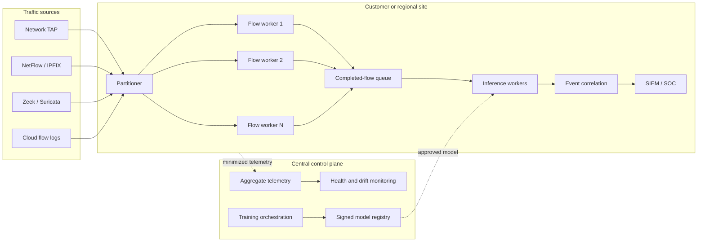

# Scalability Architecture for Cross-Network Intrusion Detection

## 1. Purpose

This document explains how the intrusion-detection platform can scale from a research notebook to multi-site production deployment. It covers network throughput, active-flow state, model inference, training volume, storage, customer growth, analyst capacity, LLM explanations, resilience, cost, and capacity planning.

The central scalability principle is:

> Scale data collection and inference locally, scale governance and controlled learning centrally, and optimize training for environmental diversity rather than indiscriminate data accumulation.

The recommended deployment remains hybrid: sensitive traffic is processed at the customer site, while a centralized control plane manages approved telemetry, monitoring, model validation, and signed model distribution.

## 2. Experimental evidence

The controlled mixed-year experiments provide an important training-scalability result:

| Training strategy | Training rows | 2017 macro F1 | 2018 macro F1 |
|---|---:|---:|---:|
| Mixed, equal total budget | 268,654 | 0.9617 | 0.9667 |
| Mixed, expanded budget | 537,308 | 0.9629 | 0.9675 |

Doubling the controlled mixed training population produced only a small performance change. The evidence suggests that exposure to different environments contributed more than simply increasing the number of rows.

Deployment implications include:

- retaining every customer flow is unnecessary;
- environment-balanced sampling can control training cost;
- rare and novel behavior should be retained preferentially;
- common benign traffic should be sampled or summarized; and
- additional data should be evaluated by information value, not volume alone.

These findings come from two research environments and must be verified with additional customer and third-dataset evidence.

## 3. Dimensions of scalability

The platform must scale across several independent dimensions.

| Dimension | Scaling driver | Primary risk |
|---|---|---|
| Packet ingestion | Packets per second and burst rate | Packet loss and sensor overload |
| Flow state | Concurrent active connections | Memory exhaustion |
| Feature extraction | Completed flows and feature complexity | Processing backlog |
| Inference | Predictions per second | Detection latency |
| Customer fleet | Sites, sensors, and policy variants | Operational complexity |
| Training | Datasets, environments, candidates, and history | Cost and slow iteration |
| Storage | Raw traffic, flows, alerts, and audit records | Cost and privacy exposure |
| Analyst workload | Alerts and incidents per hour | Alert fatigue |
| LLM explanations | Explained incidents and tokens | Cost, latency, and availability |
| Model fleet | Global and locally calibrated versions | Version sprawl and inconsistent behavior |

These dimensions should be measured and scaled separately. Increasing model-server capacity does not solve packet loss, flow-state exhaustion, or analyst overload.

## 4. Scalable logical architecture



The stateful and stateless stages are separated:

- flow construction is stateful and must preserve packet affinity;
- completed-flow inference is largely stateless and can scale horizontally;
- alert correlation operates after prediction and reduces analyst workload; and
- the control plane does not sit in the real-time detection path.

## 5. Traffic-ingestion scalability

### 5.1 Workload characteristics

The sensor layer may encounter:

- high sustained packet volume;
- short DDoS-like bursts;
- many short-lived connections;
- long-running flows;
- asymmetric routing;
- encrypted protocols;
- duplicated observations from multiple sensors; and
- malformed or deliberately adversarial packets.

Average traffic is insufficient for capacity planning. The design must accommodate peak packets per second, peak flow creation, and peak concurrent state.

### 5.2 Flow affinity

Packets belonging to the same connection must be handled by the same stateful flow worker. A stable connection key can be used:

```text
hash(source IP, destination IP, source port, destination port, protocol)
    → flow-state partition
```

Bidirectional normalization may be required so both directions of a conversation reach the same worker.

### 5.3 Horizontal partitioning

Flow workers should scale independently by adding partitions. Rebalancing requires care because moving an active partition can lose or duplicate state. Safer approaches include:

- assigning new flows to new workers while allowing existing flows to expire;
- checkpointing state when supported;
- using consistent hashing to minimize movement; and
- draining workers before maintenance.

### 5.4 Required sensor metrics

- Packets received per second
- Packets dropped per second
- New flows per second
- Concurrent active flows
- Flow completion and timeout rates
- State-memory utilization
- Parsing failures
- Duplicate and out-of-order packets
- Partition skew

## 6. Flow-state scalability

The largest edge-memory requirement may be active connection state rather than the model.

A rough planning relationship is:

```text
Flow-state memory
    ≈ concurrent active flows × average bytes of state per flow
```

The actual value must be measured because implementation overhead can exceed the raw feature counters.

Controls include:

- idle and absolute flow timeouts;
- maximum state per tenant or network segment;
- bounded state tables;
- eviction policies with observable counters;
- protection against deliberately incomplete connection floods; and
- separate handling for long-lived flows.

Aggressive timeouts reduce memory but may split legitimate long-lived sessions and alter feature definitions. Timeout settings must match training-time flow generation as closely as possible.

## 7. Feature-extraction scalability

Feature extraction should be a separate service or runtime stage from inference because it has different resource behavior.

It must provide:

- a versioned feature schema;
- deterministic units and definitions;
- consistent missing-value behavior;
- bounded processing time;
- quality and range validation; and
- compatibility with the trained model.

Feature extraction can scale through:

- partitioned flow workers;
- preallocated or memory-efficient state structures;
- vectorized transformations;
- selective computation of only required model features; and
- avoiding expensive enrichment in the critical path.

The system should reject or quarantine schema-incompatible records rather than silently changing column order or substituting unrelated values.

## 8. Inference scalability

### 8.1 Model characteristics

Logistic Regression is suitable for high-volume or edge inference because it has:

- a small memory footprint;
- predictable CPU cost;
- efficient vectorized execution;
- fast startup; and
- straightforward portability.

Boosted-tree models may improve predictive performance but require independent benchmarking for CPU, memory, prediction latency, and package size.

The most accurate offline model is not automatically the best model for every deployment tier.

### 8.2 Micro-batching

Inference can process completed flows individually or in micro-batches.

| Strategy | Advantage | Limitation |
|---|---|---|
| Single-row prediction | Lowest waiting time | Higher per-record overhead |
| Fixed batch | High throughput | Latency when traffic is low |
| Adaptive micro-batch | Balances throughput and latency | More runtime complexity |

An adaptive policy can execute when either condition is met:

- the batch reaches its target size; or
- the oldest record reaches its maximum waiting time.

### 8.3 Horizontal inference workers

Completed feature vectors can be distributed across stateless inference workers. Autoscaling signals should include:

- queue depth;
- oldest-event age;
- prediction throughput;
- p95 and p99 latency;
- CPU and memory utilization; and
- error rate.

Autoscaling based only on CPU may react too slowly to burst queues.

### 8.4 Model tiers

A practical fleet may offer:

- Logistic Regression for constrained edge devices;
- a boosted-tree model for larger on-premises servers; and
- shadow comparison between model tiers during validation.

Different models must not silently use different feature definitions or alert thresholds.

## 9. Near-real-time constraints

The present research models use completed-flow features. Prediction generally occurs when a flow ends or reaches a timeout.

End-to-end latency is therefore:

```text
Flow duration or timeout
    + feature-finalization time
    + queue wait
    + inference
    + policy evaluation
    + alert delivery
```

Optimizing inference alone cannot remove the flow-completion delay.

If subsecond prevention is required, a separate early-flow model should operate on first-packet or short-window features. The early-flow and completed-flow models can form a cascade:

```text
Early-flow detector
    ├── high confidence → immediate alert or policy action
    └── uncertain → completed-flow detector
```

The early-flow model requires its own training data, capacity tests, and false-blocking controls.

## 10. Multi-site and multi-tenant scalability

### 10.1 Local data plane and central control plane

The local data plane performs:

- traffic collection;
- flow state;
- feature extraction;
- inference;
- immediate policy; and
- short-term sensitive storage.

The central control plane performs:

- customer and sensor identity;
- configuration;
- model registry and distribution;
- fleet health;
- aggregate drift analysis;
- training orchestration; and
- audit reporting.

The local data plane must continue operating if the control plane is unavailable.

### 10.2 Tenant isolation

Every central record must carry a verified tenant and site identity. Controls include:

- per-tenant authorization;
- isolated encryption keys where required;
- regional storage for residency constraints;
- tenant-scoped retention and deletion;
- workload quotas; and
- cross-tenant access auditing.

### 10.3 Configuration hierarchy

A scalable hierarchy can be:

```text
Global defaults
    → regional policy
        → customer policy
            → site configuration
                → sensor overrides
```

Effective configuration must be inspectable so operators can determine why a sensor behaves differently.

## 11. Model-fleet scalability

A large number of completely independent customer models creates version sprawl. Each model requires validation, monitoring, deployment, and rollback.

The preferred hierarchy is:

```text
Global diverse model
    + customer-specific threshold
    + optional lightweight calibration
```

Maintain a customer-specific full model only when evidence shows that threshold and calibration changes are insufficient.

Model-registry metadata should include:

- model and preprocessing versions;
- feature-schema version;
- compatible runtime versions;
- training-data lineage;
- customer or deployment scope;
- approval status;
- signature;
- creation and expiration dates; and
- rollback predecessor.

## 12. Training scalability

### 12.1 Sampling strategy

Training should optimize coverage, not raw volume. The governed sampling process should preserve:

- diverse customer environments;
- rare attacks;
- newly observed behavior;
- different protocols and device types;
- temporal coverage;
- representative benign traffic; and
- hard false-positive examples confirmed by analysts.

High-volume redundant benign flows can be sampled, summarized, or deduplicated.

### 12.2 Preventing customer dominance

A large customer should not dominate the global model merely because it contributes more traffic. Possible controls include:

- equal site budgets;
- capped rows per class and environment;
- environment or customer sample weights;
- separate evaluation by site; and
- reporting both balanced and full-volume experiments.

### 12.3 Distributed training

Training jobs can scale by parallelizing:

- data validation by partition;
- candidate models;
- hyperparameter configurations;
- cross-validation or time windows;
- per-environment evaluation; and
- explanation or feature-importance calculations.

The final promotion decision must use fixed evaluation definitions and untouched tests. Parallelism must not turn the test set into an implicit tuning set.

### 12.4 Retraining triggers

Retraining may be justified by:

- sustained meaningful drift;
- new verified attacks;
- addition of a materially different environment;
- degradation in confirmed metrics;
- feature-schema change; or
- a scheduled governance review.

Additional accumulated data alone is not sufficient justification.

### 12.5 Federated learning

Federated learning can reduce centralized record collection, but it adds communication, secure aggregation, poisoning, update privacy, site availability, and reproducibility challenges.

It should be considered only after centralized model governance and customer identity controls are mature.

## 13. Storage scalability

Different information requires different retention and storage tiers.

| Information | Recommended location | Retention approach |
|---|---|---|
| Raw packet payload | Customer site | Short and incident-driven |
| Active flow state | Edge memory | Until completion or timeout |
| Completed flow records | Customer site | Short-to-medium, policy controlled |
| Alerts and incidents | Customer SIEM | Longer operational and audit retention |
| Aggregate health and drift | Central platform | Compact time-series retention |
| Approved training samples | Governed training store | Versioned with lineage |
| Model artifacts | Signed registry | Retain active and rollback versions |
| LLM inputs and outputs | Local or approved store | Redacted and purpose limited |

Scalability controls include:

- compression;
- time and tenant partitioning;
- lifecycle policies;
- hot, warm, and archive tiers;
- bounded local buffers;
- deduplication;
- aggregate sketches or histograms; and
- deletion verification.

Storing all raw traffic centrally is both expensive and inconsistent with the privacy-preserving architecture.

## 14. Telemetry scalability

The central platform does not need every prediction. Customer sites can send windowed summaries:

```json
{
  "site_id": "pseudonymous-site-token",
  "window": "5 minutes",
  "model_version": "binary-global-3.2",
  "flows_processed": 1250000,
  "alerts": 213,
  "latency_p95_ms": 18,
  "queue_depth_max": 1450,
  "dropped_records": 0,
  "feature_drift_score": 0.12
}
```

Windowed aggregation reduces:

- bandwidth;
- central storage;
- tenant privacy exposure;
- ingestion-service load; and
- query cost.

Detailed samples should be transferred only through an approved incident or training workflow.

## 15. Alert and analyst scalability

Infrastructure throughput is not useful if the system overwhelms analysts.

The alert pipeline should reduce flow-level predictions into actionable incidents:

```text
Predicted flows
    → thresholding
    → deduplication
    → temporal and entity correlation
    → incident scoring
    → analyst queue
```

Correlation dimensions may include:

- source or destination;
- session or five-tuple;
- asset criticality;
- time window;
- suspected attack family;
- shared model evidence; and
- threat-intelligence context.

Operational metrics include:

- alerts per thousand flows;
- alerts per customer and site;
- compression from alerts to incidents;
- incidents per analyst hour;
- acknowledgement and resolution time;
- duplicate-alert percentage;
- escalation percentage; and
- confirmed false-positive rate.

Thresholds should consider analyst capacity. A detector with excellent recall but an unmanageable alert rate is not operationally scalable.

## 16. LLM scalability

The LLM should not process every flow or every raw positive prediction.

```text
1,000,000 flows
    → 5,000 positive predictions
    → 300 correlated incidents
    → 50 high-priority explanations
```

The exact numbers will vary, but the funnel is essential.

Scalability controls include:

- asynchronous explanation queues;
- priority levels;
- per-tenant rate and token limits;
- deterministic templates for routine alerts;
- smaller local models where appropriate;
- cached security-reference retrieval;
- duplicate-evidence suppression;
- response-length limits; and
- graceful fallback during LLM failure.

LLM latency or capacity must never block primary detection or immediate alert delivery.

## 17. Backpressure and overload behavior

Every queue must be bounded and have an explicit overload policy.

Recommended degradation order:

1. Disable optional external enrichment.
2. Delay low-priority LLM explanations.
3. Reduce nonessential central telemetry frequency.
4. Preserve locally generated security alerts.
5. Apply approved sampling to low-risk benign records.
6. Record all drops and degraded-state intervals.

The system should not silently lose high-priority alerts or fail open without health notification.

For automated blocking deployments, the behavior during missing features, model failure, or overload must be agreed with the customer. Alert-only fallback is generally safer than blocking based on incomplete evidence.

## 18. Availability and resilience

### 18.1 Failure domains

Separate failure domains include:

- sensor;
- flow worker;
- local inference service;
- event queue;
- SIEM integration;
- WAN connection;
- cloud control plane;
- threat-intelligence service; and
- LLM service.

### 18.2 Required behavior

- Local inference continues during cloud outage.
- The last approved model remains available locally.
- Alerts are buffered in bounded encrypted storage.
- Optional services fail independently.
- Model updates use staged rollout and rollback.
- Health status exposes degraded operation.
- Regional or site failures do not cross tenant boundaries.

### 18.3 Model rollout at scale

Use progressive deployment rings:

```text
Internal validation
    → test sites
    → customer canary sites
    → limited production percentage
    → broad deployment
```

Promotion gates should evaluate runtime health, alert-rate change, drift, and customer-specific performance. Automatic rollback should be possible when defined guardrails are exceeded.

## 19. Cost scalability

Principal cost drivers include:

- packet capture and flow-state CPU;
- edge or on-premises hardware;
- central telemetry ingestion;
- storage retention;
- model training;
- threat-intelligence subscriptions;
- LLM tokens or hosted inference;
- cross-region data transfer; and
- analyst time.

Cost controls include:

- local aggregation;
- environment-balanced sampling;
- tiered storage;
- retention limits;
- lightweight edge models;
- incident-level rather than flow-level LLM use;
- customer quotas; and
- training triggered by evidence rather than schedule alone.

Analyst time should be treated as a first-class cost. A model that reduces infrastructure expense while increasing false alerts may increase total operational cost.

## 20. Capacity-planning objectives

Before production, define measurable service objectives for each deployment tier.

| Area | Required objective |
|---|---|
| Packet ingestion | Sustained and peak packets per second |
| Flow creation | Sustained and peak new flows per second |
| State | Maximum concurrent active flows |
| Inference | Sustained completed-flow predictions per second |
| Latency | p50, p95, and p99 flow-close-to-alert latency |
| Loss | Maximum permitted packet, flow, and alert loss |
| Availability | Local detection availability and outage behavior |
| Recovery | Restart, model rollback, and queue-recovery time |
| Telemetry | Maximum site-to-cloud bandwidth |
| Storage | Daily ingest and retention by data category |
| Analysts | Maximum incidents per analyst hour |
| LLM | Explanations per minute, tokens, latency, and cost budget |

Numerical targets should be established through requirements and load testing rather than inferred from notebook execution time.

## 21. Scalability test plan

### 21.1 Baseline tests

- Measure single-worker packet, flow, feature, and inference capacity.
- Measure memory per concurrent active flow.
- Measure model latency at different batch sizes.
- Verify feature parity under load.

### 21.2 Burst tests

- DDoS-like packet and flow-creation bursts
- Sudden short-flow spikes
- Large numbers of incomplete connections
- Long-lived-flow accumulation
- Highly skewed partitions

### 21.3 Failure tests

- Worker termination
- Queue or disk saturation
- WAN outage
- Cloud-control-plane outage
- SIEM backpressure
- Invalid or unsigned model
- Corrupted feature records
- Threat-intelligence and LLM outage

### 21.4 Fleet tests

- Staged model release across many sites
- Tenant-isolation verification
- Regional data-residency enforcement
- Configuration inheritance
- Rollback under active load

### 21.5 Operational tests

- Alert correlation effectiveness
- Analyst queue volume
- False-positive review rate
- LLM explanation priority and rate limits
- Privacy-policy validation of outbound telemetry

## 22. Scaling roadmap

### Stage 1: Single-site prototype

- One flow extractor
- One local inference process
- File or replay input
- Alert-only output
- Basic latency and throughput metrics

### Stage 2: Production-capable site

- Partitioned flow workers
- Durable completed-flow queue
- Multiple inference workers
- SIEM integration
- Bounded local storage and overload behavior

### Stage 3: Multi-site control plane

- Tenant and sensor identity
- Signed model registry
- Aggregate fleet telemetry
- Site-specific thresholds
- Canary rollout and rollback

### Stage 4: Large fleet

- Regional control-plane components
- Data-residency controls
- Automated capacity scaling
- Customer and environment-balanced training
- Incident-level LLM explanations

### Stage 5: Advanced optimization

- Early-flow detection tier
- Lightweight local calibration
- Privacy-preserving aggregation
- Carefully governed federated learning
- Adaptive placement across edge, on-premises, and cloud

## 23. Key architectural decisions

1. Keep raw traffic and flow state local by default.
2. Separate stateful flow construction from stateless inference.
3. Partition by a stable normalized flow key.
4. Use bounded queues and explicit backpressure.
5. Treat Logistic Regression as the default constrained-edge model.
6. Benchmark boosted trees separately for larger compute tiers.
7. Train on diverse, representative samples instead of retaining every flow.
8. Prefer a global model plus local thresholds over unrestricted per-customer model proliferation.
9. Export aggregate telemetry rather than individual predictions.
10. Correlate flow predictions into incidents before analyst or LLM processing.
11. Keep LLM explanation asynchronous and nonblocking.
12. Scale rollout through canary rings with automatic rollback.

## 24. Conclusion

Scalability is an end-to-end property rather than a model-server feature. The system must scale stateful packet-to-flow processing, stateless inference, customer isolation, training governance, storage, alert correlation, analyst workload, and explanation generation independently.

The project’s strongest scalability insight is that environmental diversity appears more valuable than indiscriminate training volume. This supports a design that collects small amounts of high-value, approved, representative data rather than centralizing every customer flow.

The recommended platform therefore combines:

- partitioned local flow processing;
- horizontally scalable inference;
- lightweight edge-compatible models;
- centralized but privacy-minimized governance;
- environment-balanced offline training;
- bounded storage and telemetry;
- incident-level analyst and LLM workflows; and
- explicit overload, resilience, and rollback behavior.

This approach can grow from a single-site prototype to a multi-customer fleet without requiring unrestricted collection of sensitive network data.

## Related documents

- [`WHITEPAPER.md`](WHITEPAPER.md)
- [`DEPLOYMENT_ARCHITECTURE.md`](DEPLOYMENT_ARCHITECTURE.md)
- [`TECHNOLOGY_COMPONENTS.md`](TECHNOLOGY_COMPONENTS.md)
- [`README.md`](README.md)
