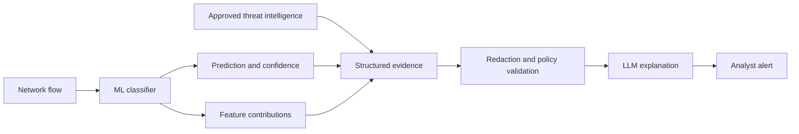
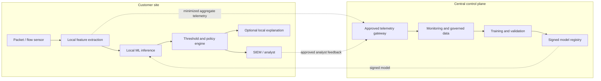

# Cross-Network Machine Learning for Intrusion Detection

## Exploratory Analysis, Model Evaluation, Generalization, and Privacy-Preserving Deployment

**Project whitepaper**  
**Status:** Research prototype and deployment design  
**Datasets:** Improved CICIDS2017 and Improved CSE-CIC-IDS2018

---

## Abstract

This project investigates whether machine-learning models trained on network-flow statistics can identify malicious traffic and, more importantly, whether those models remain effective when applied to traffic from a different network environment. Improved CICIDS2017 is used for exploratory analysis and baseline development, while Improved CSE-CIC-IDS2018 provides a second environment for distribution-shift and cross-dataset experiments.

Exploratory analysis found severe class imbalance, strongly skewed numeric features, redundant measurements, scheduled attack bursts, potential laboratory-specific shortcuts, and substantial distribution differences between the two datasets. These findings motivated the use of macro F1 and per-class metrics, chronological evaluation, and explicit cross-network testing rather than relying on accuracy or random train/test splits alone.

A Logistic Regression model provides the interpretable baseline. Tree ensembles, gradient-boosting models, and a multilayer perceptron provide nonlinear comparisons. The best preliminary chronological multiclass result was produced by the original HistGradientBoosting model with 0.9236 macro F1. Fine-tuning did not improve the leading tree models, although MLP tuning raised its chronological macro F1 from 0.7312 to 0.8075.

The principal result comes from the binary cross-dataset experiments. Models trained on a single year performed extremely well on their source environment but degraded on the other year. A 2017-only model achieved 0.9900 macro F1 on the 2017 test set but only 0.6936 on 2018. A 2018-only model achieved 0.9851 on 2018 but 0.7945 on 2017. Mixed-year training produced much more stable results: approximately 0.962–0.967 macro F1 on both test environments. Equal-budget and expanded mixed training performed almost identically, suggesting that environmental diversity contributed more than simply increasing row count.

These results support a privacy-preserving hybrid deployment. Sensitive packet and flow data should remain at the customer site, with local near-real-time feature extraction and inference. A centralized control plane should govern approved training, validation, monitoring, and signed model distribution. An optional LLM may convert model evidence into analyst-facing explanations, but it should not classify traffic or participate in the blocking path.

---

## 1. Executive summary

### Business problem

Network intrusion-detection models are often evaluated on random partitions from a single research dataset. Such results may overstate deployment performance because related flows, repeated events, and laboratory artifacts can appear in both training and testing. A production detector must operate across different networks, devices, applications, and time periods.

The primary research question is:

> Can a model flag malicious network traffic, and how well does it generalize when trained in one network environment and evaluated in another?

The secondary research question is:

> If traffic is malicious, which attack family does it most closely resemble, and do more complex models improve on an interpretable Logistic Regression baseline?

### Main conclusions

1. Random splitting produces more optimistic results than chronological evaluation.
2. Strong within-dataset performance does not establish cross-network generalization.
3. Cross-network transfer is difficult and directional.
4. Mixed-network training produces substantially more stable performance across the two represented environments.
5. Environmental diversity appears more valuable than simply adding more rows.
6. HistGradientBoosting was the strongest preliminary chronological multiclass model.
7. Fine-tuning did not improve the leading tree models; tuning helped the MLP but did not make it the best model.
8. A deployable system should combine a diverse global model with local threshold calibration and drift monitoring.
9. Customer packet payloads and identifying network metadata should remain local by default.
10. LLMs are best used for grounded explanations and analyst workflow support, not as the numeric-flow classifier.

---

## 2. Goals and scope

### 2.1 Primary goal

Build a binary classifier that answers:

> Is this connection benign or an effective attack?

The primary operational metrics are:

- attack recall;
- attack precision and F1;
- benign false-alarm rate;
- binary macro F1; and
- confusion counts.

### 2.2 Secondary goal

Evaluate multiclass models that identify attack families and determine whether nonlinear ensembles or a neural network improve on Logistic Regression.

Macro F1 is the primary multiclass metric because it calculates F1 separately for every class and gives rare classes equal weight. Weighted F1 and accuracy are secondary because common benign traffic can dominate them.

### 2.3 Out of scope

This phase does not claim:

- production readiness;
- universal detection of previously unseen attacks;
- real-world prevalence estimates from the stratified 2018 sample;
- first-packet prevention;
- validated generalization to a third independent network; or
- safe autonomous blocking without a customer-specific pilot.

---

## 3. Data

### 3.1 Dataset roles

| Dataset | Files | Approximate flows | Role |
|---|---:|---:|---|
| Improved CICIDS2017 | 5 | 2.10 million | Core EDA, baseline, and within-year modeling |
| Improved CSE-CIC-IDS2018 | 10 | 63.20 million | Extended EDA and second network environment |
| Stratified CSE-CIC-IDS2018 sample | 1 compressed CSV | 378,952 | Distribution-heavy and cross-dataset experiments |

Both improved datasets use broadly compatible flow-level schemas based on network statistics. The complete 2018 collection is approximately 36 GB and is audited in chunks. A cached stratified sample is used for model experiments that would otherwise require loading tens of millions of rows simultaneously.

The raw data files are not part of the repository because of their size. The download and preparation notebook must run before the analysis notebooks.

### 3.2 Label policy

Labels ending in `- Attempted` are treated as benign for the primary baseline because they indicate attempts that did not deliver an effective malicious payload. The advanced EDA examines the ambiguity and limitations of this decision.

### 3.3 Important data limitation

The 2018 sample caps large classes and does not preserve natural 2018 prevalence. Metrics that depend on prevalence—particularly precision and accuracy—should not be interpreted as deployment estimates. Recall, false-alarm rate, and macro F1 remain useful for controlled comparisons.

### 3.4 Data governance

The research datasets are laboratory benchmarks. A production deployment would treat raw packets, IP addresses, hostnames, URLs, user identifiers, and flow metadata as sensitive customer information. Their use requires explicit purpose, authorization, retention, and access controls.

---

## 4. Exploratory data analysis

### 4.1 Data quality

The EDA examines:

- missing and infinite values;
- constant features;
- duplicate observations;
- schema consistency;
- invalid numeric ranges;
- label counts; and
- file-level coverage.

This work prevents invalid values, repeated records, and unusable features from silently influencing model evaluation.

### 4.2 Class imbalance

Benign traffic represents approximately 75.36% of CICIDS2017 and 93.92% of CSE-CIC-IDS2018. Several attack classes contain very few observations.

Consequences include:

- accuracy can remain high while rare attacks are missed;
- weighted metrics can conceal weak minority-class results;
- random partitions may contain very small rare-class test populations; and
- per-class precision, recall, F1, and support are required.

### 4.3 Feature distributions and outliers

Network-flow variables are strongly skewed and contain extreme values. Many extreme observations are legitimate manifestations of attacks rather than erroneous data.

The project therefore uses signed-log transformations where appropriate and avoids automatically deleting statistical outliers. Outlier removal could eliminate the behavior the detector is intended to find.

### 4.4 Derived features

Derived variables improve interpretability and expose relationships that may be difficult to see in raw counters. Examples include traffic direction ratios, rates, and grouped temporal summaries.

The purpose of feature engineering is not merely to increase the column count. It should represent operational behavior such as asymmetry, intensity, burstiness, or duration in forms that analysts and models can interpret.

### 4.5 Protocol and destination-port analysis

Protocol and port distributions help determine whether attacks rely on specific transport behavior or services. They also reveal a risk: models may learn laboratory topology, port assignments, or device configuration instead of transferable malicious behavior.

Large categories can hide smaller protocol groups when plotted on a common linear scale, so annotated counts and appropriate scaling are used to preserve visibility.

### 4.6 Attack timing

CICIDS attacks occur in scheduled temporal bursts. Random splitting can distribute related flows from the same event across training and testing, allowing the model to recognize event-specific characteristics rather than general attack behavior.

Chronological evaluation is therefore emphasized. It is still an approximation because flows from the same laboratory campaign may share characteristics across time, but it is more realistic than unrestricted random splitting.

### 4.7 Correlation and multicollinearity

Many flow variables are mathematical derivatives or closely related counters. Strong correlation can:

- make coefficients unstable;
- spread importance across redundant features;
- increase computational cost; and
- complicate interpretation.

Correlation and feature-clustering analyses identify these relationships. Predictive models may retain correlated variables, but coefficient-level explanations must acknowledge the redundancy.

### 4.8 PCA and separability

Principal component analysis provides a lower-dimensional view of class structure. It helps determine whether attacks form visibly distinct regions or overlap with benign traffic.

PCA is used as an exploratory visualization rather than proof that classes are separable in production.

### 4.9 Cross-year drift

The 2017 and 2018 datasets share many feature names but differ in benign prevalence, attack families, protocols, devices, and feature distributions. These differences motivate explicit cross-year testing and make a single-dataset score insufficient.

---

## 5. Evaluation methodology

### 5.1 Random evaluation

A stratified random split provides comparability with common machine-learning practice. It is retained as a secondary benchmark.

### 5.2 Chronological evaluation

Within each label, earlier observations are used for training and later observations for testing. This preserves rare-class representation while reducing direct temporal leakage.

Chronological results are treated as more representative of future-period detection than random results.

### 5.3 Cross-dataset evaluation

The cross-dataset experiment trains on one environment and evaluates on the other. It also evaluates mixed-year training under two conditions:

- **equal total budget:** half of the fixed row budget comes from each year;
- **expanded budget:** a full controlled sample from each year is used.

The equal-budget design isolates environmental diversity from row count. The expanded design measures the practical result of diversity plus additional data.

### 5.4 Leakage controls

- Each year is split before datasets are mixed.
- Test partitions remain untouched during training.
- Hyperparameters are selected using a separate validation interval.
- The 2018 external evaluation is not used to select the original baseline.
- Identifiers, labels, and timestamps are excluded from predictors.

---

## 6. Logistic Regression baseline

Logistic Regression is used because it is:

- interpretable;
- computationally efficient;
- reproducible;
- suitable for high-dimensional numeric data; and
- a useful minimum-complexity reference.

The baseline applies a signed-log transformation, standardization, L2 regularization, and balanced class weights.

### 6.1 Baseline multiclass results

| Split | Macro F1 | Attack macro F1 |
|---|---:|---:|
| Random | 0.8241 | — |
| Chronological | 0.7278 | 0.7101 |

The random score is materially higher than the chronological score. This confirms that evaluation design affects the performance estimate and supports using time-aware results for model selection.

### 6.2 Logistic Regression tuning

Multiclass tuning evaluated L2 regularization strength and balanced versus unweighted fitting using an early training period, a middle validation period, and a final untouched chronological test period.

| Model | Random macro F1 | Chronological macro F1 | Attack macro F1 |
|---|---:|---:|---:|
| Untuned Logistic Regression | 0.8241 | 0.7278 | 0.7101 |
| Tuned Logistic Regression | 0.8298 | 0.7746 | 0.7598 |

The selected multiclass configuration was unweighted L2 Logistic Regression with `C=1.0`. It improved chronological macro F1 primarily through higher macro precision, but macro recall declined for some attacks. The tuned model is more conservative and is not uniformly better.

Separate binary tuning selected the original balanced `C=1.0` settings. Binary tuning therefore did not improve the primary cross-network detector.

---

## 7. Nonlinear model comparison

The project evaluates several model families because they represent different assumptions:

- **Random Forest:** nonlinear bagging baseline;
- **Extra Trees:** stronger split randomization;
- **HistGradientBoosting:** efficient sequential boosting;
- **XGBoost:** regularized gradient boosting;
- **LightGBM:** efficient leaf-wise boosting; and
- **MLP:** a neural-network comparison for standardized tabular data.

### 7.1 Preliminary chronological results

| Model | Chronological macro F1 | Attack macro F1 |
|---|---:|---:|
| Logistic Regression baseline | 0.7278 | 0.7101 |
| MLP `(128, 64)` | 0.7312 | 0.7136 |
| Random Forest | 0.8908 | 0.8836 |
| Extra Trees | 0.8924 | 0.8853 |
| XGBoost | 0.9108 | 0.9051 |
| LightGBM | 0.9182 | 0.9129 |
| HistGradientBoosting | **0.9236** | **0.9186** |

HistGradientBoosting produced the strongest chronological multiclass result. The original MLP only slightly exceeded Logistic Regression and remained far behind the tree ensembles.

### 7.2 Fine-tuning results

| Model | Base macro F1 | Tuned macro F1 | Change | Preferred version |
|---|---:|---:|---:|---|
| HistGradientBoosting | 0.9236 | 0.9199 | -0.0037 | Base |
| LightGBM | 0.9182 | 0.9182 | 0.0000 | Base |
| XGBoost | 0.9108 | 0.9053 | -0.0055 | Base |
| Extra Trees | 0.8924 | 0.8924 | 0.0000 | Base |
| Random Forest | 0.8908 | 0.8908 | 0.0000 | Base |
| MLP | 0.7312 | 0.8075 | +0.0763 | Tuned |

Tuning did not improve the leading tree models. The MLP improved substantially but remained below the untuned HistGradientBoosting model.

This is an important negative result: a validation search does not guarantee better future-period performance, and additional tuning complexity should not be assumed to improve deployment value.

---

## 8. Cross-dataset experiments

### 8.1 Design

Four fixed binary Logistic Regression strategies are compared:

1. 2017 only;
2. 2018 only;
3. mixed years with the same total training budget; and
4. mixed years with an expanded budget.

Every strategy is tested separately on untouched chronological 2017 and 2018 partitions using a common numeric feature set.

### 8.2 Results

| Training strategy | Training rows | 2017 macro F1 | 2018 macro F1 |
|---|---:|---:|---:|
| 2017 only | 268,654 | 0.9900 | 0.6936 |
| 2018 only | 268,654 | 0.7945 | 0.9851 |
| Mixed, equal budget | 268,654 | 0.9617 | 0.9667 |
| Mixed, expanded budget | 537,308 | 0.9629 | 0.9675 |

### 8.3 Attack recall

| Training strategy | 2017 attack recall | 2018 attack recall |
|---|---:|---:|
| 2017 only | 0.9912 | 0.4424 |
| 2018 only | 0.6832 | 0.9841 |
| Mixed, equal budget | 0.9865 | 0.9778 |
| Mixed, expanded budget | 0.9870 | 0.9776 |

### 8.4 False-alarm rates

| Training strategy | 2017 false-alarm rate | 2018 false-alarm rate |
|---|---:|---:|
| 2017 only | 0.64% | 4.93% |
| 2018 only | 9.19% | 1.37% |
| Mixed, equal budget | 3.09% | 4.10% |
| Mixed, expanded budget | 2.99% | 3.94% |

### 8.5 Interpretation

The single-year models are highly specialized. Their strong source-domain results do not transfer uniformly.

- Forward transfer, 2017 to 2018, is particularly weak because attack recall falls to 0.4424.
- Reverse transfer, 2018 to 2017, is better but produces a 9.19% false-alarm rate.
- Mixed training sacrifices a small amount of source-domain performance but substantially improves balance across both environments.
- Equal-budget and expanded mixed results differ by approximately 0.001 macro F1, indicating that diversity—not only data volume—explains most of the improvement.

Mixed training should not be described as proof of unseen-network generalization because both evaluated environments are represented during training. A third independent environment must remain completely excluded from development.

---

## 9. Neural networks, CNNs, RNNs, and transformers

### 9.1 MLP

An MLP is a reasonable neural baseline for standardized tabular flow features. Tuning improved the model, but it did not outperform the tree ensembles.

### 9.2 CNN

A one-dimensional CNN can technically consume a feature vector, but the order of tabular columns is largely arbitrary. Adjacent CSV columns do not necessarily have a meaningful local relationship. A CNN is more defensible when applied to temporal traffic windows or packet sequences.

### 9.3 RNN, LSTM, or GRU

An RNN should not treat different feature columns as time steps. A sequence model becomes meaningful only when genuine chronological sequences are constructed by source, destination, session, five-tuple, or time window.

Sequence models could detect scanning, beaconing, repeated failures, bursts, or multistage behavior, but they require reliable identifiers, ordering, careful leakage controls, and a new evaluation design.

### 9.4 Tabular and traffic transformers

A tabular transformer is more appropriate than converting numeric rows into artificial sentences. A temporal transformer may be useful for real flow sequences. Neither should be called an LLM unless it is actually a large language model trained for language tasks.

---

## 10. LLM-assisted analyst workflow

### 10.1 Appropriate role

The LLM should not replace the flow classifier. Numeric structured models are faster, more deterministic, less expensive, and more natural for the available features.

The recommended LLM use is grounded explanation:



### 10.2 Possible capabilities

- Explain why an alert was produced.
- Summarize related suspicious flows.
- Describe the strongest contributing features.
- Retrieve relevant MITRE ATT&CK documentation.
- Create a concise incident report.
- Answer natural-language questions about saved experiment results.
- Draft, but never automatically deploy, detection rules.

### 10.3 Guardrails

- The LLM receives structured evidence, not unrestricted raw packet content.
- Observed facts, model inferences, external intelligence, and analyst confirmation are clearly separated.
- Numeric claims must match the supplied evidence.
- The LLM cannot change the classifier decision or blocking policy.
- Prompt injection from logs and retrieved content must be treated as hostile input.
- Regulated customers may require a local LLM or deterministic templates.

This extension has been designed conceptually but has not yet been implemented or evaluated.

---

## 11. Newer and real-time data

### 11.1 Newer labeled datasets

Potential external datasets include:

- CIC-BCCC-NRC TabularIoTAttack-2024;
- CIC IoT-DIAD 2024;
- CICIoMT 2024;
- CICAPT-IIoT 2024;
- DataSense CIC IIoT 2025; and
- CIC-YNU-IoTMal 2026.

TabularIoTAttack-2024 is the easiest likely integration because it uses tabular CICFlowMeter features. DataSense 2025 offers a more recent industrial environment but may require additional schema alignment. CICAPT-IIoT is attractive for an LLM and MITRE ATT&CK explanation experiment but is not a direct feature-compatible replacement.

Dataset recency does not mean the data contain all current real-world attacks. Most public security benchmarks are controlled laboratory collections.

### 11.2 Real-time sources

Possible contemporary sources include:

- authorized local packet or flow capture;
- MAWI daily backbone traces;
- CAIDA network-telescope traffic;
- GreyNoise scanner intelligence; and
- URLhaus or ThreatFox indicators.

Live traffic usually lacks trustworthy per-flow ground-truth labels. It is suitable for shadow deployment, throughput measurement, alert-volume analysis, and drift detection. Accuracy and F1 should not be reported without defensible labels.

### 11.3 Controlled real-time evaluation

A labeled real-time experiment should use an isolated authorized test environment with documented benign activity and controlled attack windows. This enables measurement of attack recall, false alarms, processing latency, time to first detection, and explanation quality.

---

## 12. Deployment architecture

### 12.1 Recommended target state

The recommended target is a privacy-preserving hybrid platform:



### 12.2 Deployment modes

| Mode | Strength | Limitation | Best fit |
|---|---|---|---|
| Cloud only | Centralized and elastic | Data export, latency, and residency | Cloud-native customers permitting export |
| On-premises | Strong local control | Customer capacity and upgrade complexity | Regulated enterprise environments |
| Edge | Lowest latency and WAN independence | Limited compute and storage | Branch, factory, and IoT gateways |
| Hybrid | Balances privacy, latency, and governance | More components | Recommended general deployment |

### 12.3 Training architecture

The central training process should use public data, controlled test data, and explicitly approved customer samples. It should prioritize environment diversity rather than allowing one high-volume source to dominate.

```text
Approved data
  → schema and privacy validation
  → quality controls
  → environment and chronological splits
  → training
  → within-domain evaluation
  → cross-domain evaluation
  → security and privacy review
  → signed model registry
```

The global mixed model should be combined with customer-specific threshold calibration. Complete per-customer models should be introduced only when evidence shows threshold adjustment is insufficient.

### 12.4 Inference architecture

```text
Traffic sensor
  → flow assembly
  → schema validation
  → feature transformation
  → local classifier
  → threshold and policy
  → alert queue
  → SIEM / SOC / SOAR
```

Preprocessing and classification must be packaged together. Feature names, order, units, missing-value handling, transformations, scaler parameters, model weights, and threshold policy must all be versioned.

### 12.5 Real-time limitation

The current features describe completed flows. The detector is therefore near-real-time and generally acts after flow completion or timeout. A separate early-flow model is required for subsecond prevention using first-packet or short-window features.

### 12.6 Sensitive-data collection

Raw packet payloads, internal IP addresses, hostnames, URLs, user identifiers, device names, and unredacted captures should remain local unless separately authorized.

Recommended collection tiers are:

| Tier | Centrally shared information |
|---|---|
| Local only | Model version and health |
| Aggregate | Counts, latency, alert rate, feature histograms, and drift |
| De-identified flows | Approved numeric features with identifiers removed |
| Incident samples | Analyst-approved records and outcomes |
| Raw capture | Exceptional, time-limited, separately authorized evidence |

### 12.7 LLM placement

The LLM should operate asynchronously after the deterministic classifier. Detection must continue when the LLM or cloud is unavailable. External LLM services should receive only redacted structured evidence explicitly allowed by customer policy.

### 12.8 Release lifecycle

```text
Training
  → validation
  → cross-dataset testing
  → security and privacy review
  → signed registry
  → shadow deployment
  → canary deployment
  → limited production
  → broad deployment
```

Every model requires lineage, evaluation results, approval, a cryptographic signature, compatibility metadata, a rollback package, and a review or expiration date.

### 12.9 Monitoring

Monitor:

- sensor and feature-pipeline health;
- flows and packets per second;
- inference and end-to-end latency;
- queues and dropped events;
- missing or malformed features;
- feature and prediction drift;
- alerts per thousand flows;
- confirmed false positives;
- attack recall where labels are available;
- outbound privacy-policy violations; and
- model version and signature status.

Drift should trigger investigation and controlled validation, not automatic retraining.

### 12.10 Federated learning

Federated learning may eventually support customers that prohibit flow export, but it introduces update leakage, poisoning, heterogeneous data, secure-aggregation, reproducibility, and governance risks. It is not recommended for the first release.

The complete deployment design is documented in [`DEPLOYMENT_ARCHITECTURE.md`](DEPLOYMENT_ARCHITECTURE.md).

Detailed throughput, state-management, training-volume, multi-tenant, alert-capacity, LLM, resilience, and cost considerations are documented in [`SCALABILITY_ARCHITECTURE.md`](SCALABILITY_ARCHITECTURE.md).

The model lifecycle, platform-operations automation, and analyst-feedback operating model are documented in [`MLOPS_AIOPS_OPERATING_MODEL.md`](MLOPS_AIOPS_OPERATING_MODEL.md).

Concrete technology choices for the research environment, customer-site data plane, central control plane, MLOps, AIOps, SecOps, security, and LLM explanation layer are documented in [`TECHNOLOGY_COMPONENTS.md`](TECHNOLOGY_COMPONENTS.md).

---

## 13. Security and governance

### 13.1 Threats against the ML system

- Evasion through manipulated traffic characteristics
- Poisoned feedback and training data
- Forged or substituted model packages
- Compromised sensors or feature pipelines
- Model extraction and privacy leakage
- Flow-flood denial of service
- Cross-tenant data access
- Prompt injection through logs or retrieved content

### 13.2 Required controls

- Mutual authentication between services
- Least-privilege identities
- Signed model artifacts
- Encryption in transit and at rest
- Tenant isolation
- Immutable audit logs
- Input validation and rate limits
- Protected analyst-feedback channels
- Independent validation before retraining
- Canary deployment and tested rollback

The design should follow resource-centered zero-trust principles. NIST emphasizes that trust should not be granted solely because a resource is located on an internal network. See [NIST SP 800-207](https://csrc.nist.gov/pubs/sp/800/207/final).

NIST’s adversarial-ML taxonomy identifies evasion, poisoning, privacy, and other attacks across the AI lifecycle. See [NIST Adversarial Machine Learning](https://www.nist.gov/publications/adversarial-machine-learning-taxonomy-and-terminology-attacks-and-mitigations).

### 13.3 Human oversight

The initial production mode should be alert-only. Automated blocking requires a higher confidence threshold, lower false-positive evidence, customer approval, exception handling, and a reliable rollback path.

Analyst-confirmed outcomes should be collected through an authenticated workflow and reviewed before entering any training dataset.

---

## 14. Limitations

1. Both principal datasets were generated in controlled research environments.
2. The 2018 modeling work uses a stratified sample rather than all 63.2 million flows.
3. The 2018 sample does not preserve natural prevalence.
4. Chronological splitting reduces but does not eliminate laboratory-event dependencies.
5. Mixed-year results measure stability across represented environments, not a completely unseen network.
6. Attack-family labels do not align perfectly across datasets.
7. Models may learn environmental shortcuts such as ports, protocols, or TCP-window patterns.
8. Flow-completion features cannot guarantee first-packet prevention.
9. Live traffic generally lacks verified labels.
10. The LLM explanation component has not yet been implemented or evaluated.

---

## 15. Recommended next work

### Immediate

1. Select an untouched 2024 or 2025 flow dataset.
2. Determine the common feature intersection.
3. Retrain the 2017-only, 2018-only, and mixed models using that fixed schema.
4. Freeze models and thresholds before evaluating the third environment.
5. Compare macro F1, attack recall, and false-alarm rate.

### Deployment prototype

1. Package preprocessing and the mixed Logistic Regression model as a signed runtime artifact.
2. Build a PCAP or flow replay harness.
3. Verify notebook-to-runtime feature parity.
4. Measure throughput and latency.
5. Deploy in shadow mode at an authorized test site.

### Analyst explanation

1. Calculate feature contributions.
2. Define a structured evidence schema.
3. Redact sensitive fields locally.
4. Generate deterministic and LLM explanations.
5. Evaluate factual consistency, hallucination rate, clarity, and analyst usefulness.

### Longer term

- Develop a separate early-flow detector.
- Evaluate genuine flow sequences with an LSTM, GRU, temporal CNN, or transformer.
- Add controlled local calibration.
- Consider privacy-preserving aggregation and federated learning.
- Validate canary deployment and automated rollback.

---

## 16. Conclusion

The project demonstrates why network-intrusion models must be evaluated beyond a single random split. Single-year models produced excellent results on their source environments but transferred poorly, confirming that benchmark success can depend on network-specific distributions. Mixed-network training yielded much more stable performance across the two represented years, and the equal-budget experiment suggests that environmental diversity matters more than simply adding observations.

The strongest current multiclass model is the original HistGradientBoosting configuration, while Logistic Regression remains valuable as an efficient, interpretable, and edge-deployable binary baseline. Fine-tuning improved the MLP but did not improve the leading ensembles.

The findings support a hybrid production architecture: keep sensitive data and near-real-time inference at the customer site; centralize only governed training, monitoring, approval, and signed model distribution; calibrate behavior locally; and treat cross-network drift as a continuing operational condition. An LLM can add value by explaining grounded model evidence, but it should remain outside the detection and enforcement path.

The next decisive test is an untouched third environment. Until that test is completed, the correct conclusion is that mixed training improves robustness across two known research environments—not that the model universally generalizes to unseen production networks.

---

## 17. Reproducibility and project artifacts

### Phase 1

- `00_download_data.ipynb` — download and prepare data
- `EDA/01_eda.ipynb` — core grading-aligned EDA
- `EDA/01_eda_advanced_questions.ipynb` — advanced Q1–Q6 analysis
- `EDA/01_eda_2018_extended.ipynb` — extended 2018 analysis
- `baseline/02_logistic_regression_baseline.ipynb` — required baseline
- `docs/README_EDA.md` — EDA methodology and rationale

### Phase 2

- `02_logistic_regression_tuning.ipynb`
- `02_ensemble_models_cicids2017.ipynb`
- `03_mlp_experiment.ipynb`
- `04_histgb_fine_tuning.ipynb`
- `05_all_model_tuning.ipynb`
- `06_cross_dataset_experiments.ipynb`
- `DEPLOYMENT_ARCHITECTURE.md`

Generated CSV files preserve summary, per-class, tuning, confusion-count, and attack-family results.

---

## 18. AI-assisted development disclosure

Generative AI tools were used to assist with code drafting, documentation, and editing. The project author reviewed, tested, and revised the generated material and is responsible for the analysis, methodology, results, and conclusions.

This disclosure should be adjusted if the course or institution requires a particular format, tool name, prompt log, or level of detail.

---

## References

- Canadian Institute for Cybersecurity, [CICIDS2017](https://www.unb.ca/cic/datasets/ids-2017.html)
- Canadian Institute for Cybersecurity, [CSE-CIC-IDS2018](https://www.unb.ca/cic/datasets/ids-2018.html)
- Canadian Institute for Cybersecurity, [Dataset catalog](https://www.unb.ca/cic/datasets/index.html)
- NIST, [AI Risk Management Framework](https://www.nist.gov/itl/ai-risk-management-framework)
- NIST, [SP 800-207: Zero Trust Architecture](https://csrc.nist.gov/pubs/sp/800/207/final)
- NIST, [SP 1800-35: Implementing a Zero Trust Architecture](https://csrc.nist.gov/pubs/sp/1800/35/final)
- NIST, [Adversarial Machine Learning: A Taxonomy and Terminology of Attacks and Mitigations](https://www.nist.gov/publications/adversarial-machine-learning-taxonomy-and-terminology-attacks-and-mitigations)
