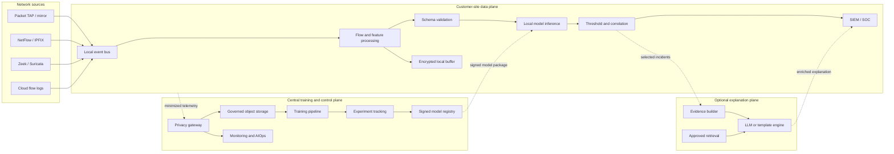

# Technology Components for the Intrusion-Detection Platform

## 1. Purpose

This document identifies the technology components required to take the cross-network intrusion-detection project from exploratory notebooks to a deployable, scalable, privacy-preserving platform.

It distinguishes among:

- the current research stack;
- the minimum viable deployment stack;
- the customer-site data plane;
- the central training and control plane;
- MLOps, AIOps, and SecOps components;
- the optional LLM explanation layer; and
- components that should be introduced only when scale or policy justifies them.

The recommended architecture is technology-neutral at its boundaries. Specific products are examples and may be replaced with equivalent customer-approved services.

## 2. End-to-end component map



The control plane must not be required for immediate local detection. Customer sites should continue using the last approved model during cloud or WAN outages.

## 3. Research and development stack

These components support the current EDA, modeling, and documentation workflow.

| Capability | Recommended technology | Project status |
|---|---|---|
| Programming language | Python | In use |
| Interactive analysis | JupyterLab / Jupyter Notebook | In use |
| Data manipulation | pandas, NumPy | In use |
| Visualization | Matplotlib, Seaborn | In use |
| Statistical analysis | SciPy | In use |
| Traditional ML | scikit-learn | In use |
| Boosted models | XGBoost, LightGBM | In use |
| Deep learning | PyTorch or TensorFlow | Future sequence experiments |
| Explainability | SHAP, permutation importance | Recommended next step |
| Environment management | Conda, `venv`, or Poetry | Required for reproducibility |
| Source control | Git and GitHub | Required |
| Data versioning | DVC or versioned object storage | Recommended |
| Automated testing | pytest, nbval, executed `nbconvert` | Recommended |

The research repository should contain:

```text
environment.yml or requirements.txt
data download and preparation workflow
EDA notebooks
modeling notebooks
saved metrics
model artifacts
tests
architecture documents
```

Raw datasets should remain outside normal Git history because of size and licensing or privacy considerations.

## 4. Network collection layer

The production platform needs one or more authorized sources of network telemetry.

### 4.1 Packet-level sources

Options include:

- network TAP;
- switch port mirroring;
- `libpcap`;
- tcpdump;
- TShark; and
- cloud packet-mirroring services.

Packet capture provides the richest data but creates the highest volume, privacy exposure, and retention cost. Packet payload should remain local by default.

### 4.2 Flow and security telemetry

Preferred sources for the initial deployment are:

- Zeek;
- Suricata;
- NetFlow;
- IPFIX;
- cloud VPC or virtual-network flow logs; and
- a CICFlowMeter-compatible extractor for research parity.

Zeek and Suricata produce protocol and security metadata in addition to flows. NetFlow and IPFIX reduce volume but may not expose every feature available in the research datasets.

### 4.3 Feature-adapter requirement

A production feature adapter is essential:

```text
Zeek / NetFlow / Suricata records
              ↓
      Versioned feature adapter
              ↓
    Model-compatible feature schema
```

A model trained on CICFlowMeter-derived columns cannot directly consume an arbitrary NetFlow or Zeek schema. The adapter must document how every production field maps to the training feature, including units, direction, timeouts, missing behavior, and unsupported fields.

## 5. Customer-site data plane

Each customer site requires the following logical components:

1. Traffic sensor or flow collector
2. Flow assembler or normalizer
3. Feature extractor and adapter
4. Schema and quality validator
5. Local model-inference runtime
6. Threshold and policy engine
7. Alert correlation service
8. Local event queue
9. SIEM connector
10. Encrypted local buffer
11. Health and metrics agent
12. Privacy gateway for permitted outbound telemetry

### Suggested technologies

| Component | Technology options |
|---|---|
| Flow collection | Zeek, Suricata, IPFIX collector |
| Prototype feature processing | Python |
| High-throughput feature processing | Rust, Go, Java, Flink, or optimized Python |
| Local event bus | NATS, RabbitMQ, Redpanda, Kafka |
| Stateful stream processing | Apache Flink, Kafka Streams |
| Message schema | Apache Avro, Protocol Buffers, JSON Schema |
| Inference runtime | scikit-learn, ONNX Runtime |
| Service interface | gRPC or FastAPI |
| Local state | Embedded memory, RocksDB, Redis, or Flink state |
| Durable local buffer | Encrypted object storage or persistent event queue |
| Packaging | Docker or a signed native package |
| Edge orchestration | K3s, Kubernetes, systemd, or appliance supervisor |

The first prototype should remain simple:

```text
Zeek or prepared flow input
    → Python feature adapter
    → schema validation
    → packaged scikit-learn model
    → alert JSON or syslog
    → SIEM
```

Kafka, Flink, and Kubernetes should be added only when traffic volume, service count, resilience, or multi-site operations justify them.

## 6. Streaming and messaging layer

A production system should decouple collection, feature processing, inference, and alerting:

```text
Traffic collector
    → raw-flow topic
    → feature workers
    → validated-feature topic
    → inference workers
    → alert topic
    → correlation and SIEM
```

### Technology selection by scale

| Deployment scale | Appropriate technology |
|---|---|
| Notebook or functional prototype | Files, Python queues, or direct function calls |
| Small customer site | NATS, RabbitMQ, or Redpanda |
| Large customer site | Kafka or Redpanda |
| Stateful event-time processing | Apache Flink |
| Managed cloud streaming | AWS Kinesis, Azure Event Hubs, Google Pub/Sub |

Required messaging features include:

- bounded retention;
- backpressure;
- consumer monitoring;
- tenant and site identity;
- replay for investigation;
- schema compatibility; and
- encryption and access control.

## 7. Data quality and schema validation

Production validation should detect:

- missing required fields;
- wrong types or units;
- NaN and infinite values;
- invalid ranges;
- feature-order differences;
- unsupported schema versions;
- timestamp problems;
- unexpected null rates; and
- incompatible flow-timeout behavior.

Technology options include:

- Pandera;
- Pydantic;
- Great Expectations;
- TensorFlow Data Validation; and
- optimized custom validators for high-throughput paths.

Pandera or Pydantic is sufficient for the initial Python implementation. Validation failures should be quarantined and counted rather than silently modified.

## 8. Model inference components

### 8.1 Packaged inference artifact

The production artifact should contain:

```text
signed-model-package
├── feature schema and order
├── preprocessing transformations
├── imputer
├── scaler
├── classifier
├── threshold policy
├── evaluation report
├── compatibility metadata
└── cryptographic signature
```

### 8.2 Runtime choices

| Requirement | Appropriate technology |
|---|---|
| Initial Logistic Regression service | Native scikit-learn pipeline |
| Portable optimized CPU inference | ONNX Runtime |
| Lightweight HTTP endpoint | FastAPI |
| High-performance service interface | gRPC |
| Managed Kubernetes model serving | KServe, Seldon, BentoML |
| Multi-model GPU serving | NVIDIA Triton |

Logistic Regression does not require a large model-serving platform or GPU. A lightweight local process or ONNX Runtime is sufficient.

Boosted-tree and future deep-learning models should be benchmarked for throughput, memory, package size, and p95/p99 latency before deployment.

## 9. Central training platform

The central training environment turns approved data into reproducible candidate models.

| Capability | Technology options |
|---|---|
| Workflow orchestration | Airflow, Prefect, Dagster |
| Distributed processing | Spark, Dask, Ray |
| Experiment tracking | MLflow, Weights & Biases |
| Model registry | MLflow Model Registry or managed cloud registry |
| Hyperparameter tuning | Optuna, Ray Tune |
| Data validation | Great Expectations, Pandera |
| Feature store | Feast, if online/offline reuse justifies it |
| Artifact storage | S3, Azure Blob, GCS, MinIO |
| Metadata database | PostgreSQL |
| Secrets | Vault or cloud secret manager |

### Recommended initial central stack

```text
GitHub
  + Python and Jupyter
  + Prefect or Airflow
  + MLflow
  + PostgreSQL
  + S3 or MinIO
  + Docker
```

Spark, Ray, or a feature store should be introduced only when single-machine processing and direct feature pipelines no longer meet requirements.

## 10. Storage components

| Information | Recommended storage |
|---|---|
| Raw PCAP | Local encrypted object storage |
| Active flow state | Memory, RocksDB, or Flink state |
| Completed flows | Parquet in local object storage |
| Approved training data | S3, Blob, GCS, or MinIO using Parquet |
| Experiment metadata | MLflow and PostgreSQL |
| Model artifacts | Registry plus object storage |
| Operational metrics | Prometheus-compatible time-series storage |
| Logs | Loki, OpenSearch, Elasticsearch, or Splunk |
| Security alerts | Customer SIEM |
| Audit records | Append-only or immutable storage |
| LLM retrieval documents | pgvector, OpenSearch vector search, or approved vector database |

Parquet is preferable to CSV for production-scale numeric flow data because it is compressed, typed, and columnar.

Storage policies should define encryption, tenant isolation, residency, retention, archival, deletion, and legal hold.

## 11. MLOps components

MLOps provides model reproducibility and lifecycle governance.

Required components include:

- source control;
- reproducible build environment;
- dataset and split versions;
- feature-schema versions;
- experiment tracker;
- model registry;
- validation gates;
- approval workflow;
- signed artifact distribution;
- shadow and canary deployment;
- fleet model inventory;
- model monitoring; and
- rollback.

### Suggested technologies

| Capability | Technology |
|---|---|
| Source control | GitHub or GitLab |
| Data versions | DVC or versioned object-storage manifests |
| Orchestration | Prefect, Airflow, Dagster |
| Tracking and registry | MLflow |
| Tuning | Optuna |
| CI/CD | GitHub Actions, GitLab CI, Jenkins |
| Image registry | GHCR, ECR, ACR, GCR |
| Artifact signing | Sigstore/Cosign |
| GitOps deployment | Argo CD or Flux |
| Deployment policy | Open Policy Agent |

Recommended lifecycle:

```text
Candidate → Validated → Approved → Shadow → Canary → Production → Retired
```

Detailed responsibilities are defined in [`MLOPS_AIOPS_OPERATING_MODEL.md`](MLOPS_AIOPS_OPERATING_MODEL.md).

## 12. Observability and AIOps components

### 12.1 Observability foundation

| Capability | Technology options |
|---|---|
| Metrics | Prometheus |
| Instrumentation and traces | OpenTelemetry |
| Dashboards | Grafana |
| Logs | Loki, OpenSearch, Elasticsearch, Splunk |
| Alerting | Alertmanager, PagerDuty, Opsgenie, ServiceNow |
| Model drift | Evidently, WhyLabs, Arize, Fiddler, custom metrics |

For an initial implementation, Prometheus, Grafana, Loki or OpenSearch, Alertmanager, and Evidently provide a practical open-source foundation.

### 12.2 AIOps layer

AIOps builds on observability to provide:

- anomaly detection;
- event correlation;
- probable root-cause analysis;
- capacity recommendations;
- model-rollout impact analysis;
- controlled remediation; and
- outage and degradation prediction.

Commercial options include Splunk ITSI, Dynatrace, Datadog, New Relic, and ServiceNow ITOM. A prototype can use custom Python analytics over Prometheus and OpenSearch telemetry.

## 13. SecOps and SIEM integration

The platform should integrate with the customer’s existing security workflow.

Possible SIEM destinations include:

- Splunk;
- Microsoft Sentinel;
- Elastic Security;
- IBM QRadar;
- Google Security Operations; and
- Sumo Logic.

Integration methods include:

- syslog;
- JSON over HTTPS;
- Kafka;
- webhooks;
- STIX/TAXII; and
- vendor APIs.

The alert schema should include:

- event and observation time;
- model and feature-schema versions;
- prediction and confidence;
- applied threshold;
- important contributing features;
- pseudonymous flow or session reference;
- customer and site identity;
- approved threat intelligence;
- explanation status; and
- analyst disposition.

Sensitive identifiers should remain local or be tokenized according to customer policy.

## 14. Threat-intelligence components

Optional enrichment sources and platforms include:

- GreyNoise;
- URLhaus;
- ThreatFox;
- MISP;
- OpenCTI; and
- commercial threat-intelligence services.

| Capability | Technology |
|---|---|
| Threat-intelligence platform | MISP or OpenCTI |
| Interchange standard | STIX/TAXII |
| Local cache | Redis |
| Policy enforcement | Local enrichment gateway |

Threat intelligence provides supporting evidence. It should not automatically establish that an individual connection is malicious.

## 15. LLM explanation components

### Required services

1. Structured evidence builder
2. Feature-contribution service
3. Sensitive-data redactor
4. Retrieval service
5. Approved document store
6. LLM gateway or local model runtime
7. Prompt and response validator
8. Explanation audit log
9. Deterministic fallback templates

### Hosting choices

| Customer restriction | Appropriate approach |
|---|---|
| Approved external API | Managed enterprise LLM endpoint |
| Private cloud required | Customer-controlled hosted endpoint |
| Data cannot leave customer site | Local model with vLLM, Ollama, or approved runtime |
| LLM prohibited | Deterministic explanation templates |

### Retrieval technologies

- pgvector;
- OpenSearch vector search;
- approved managed vector database; or
- a small local document index.

Retrieval sources may include:

- MITRE ATT&CK documentation;
- customer incident procedures;
- internal runbooks;
- model documentation; and
- approved threat-intelligence reports.

The LLM must remain outside the blocking path:

```text
Classifier → immediate alert
          ↘ asynchronous explanation queue → LLM → enriched alert
```

## 16. Security and identity components

| Capability | Technology examples |
|---|---|
| Workload identity | SPIFFE/SPIRE, cloud IAM |
| Transport protection | Mutual TLS |
| Certificate automation | cert-manager or enterprise PKI |
| Secrets | HashiCorp Vault or cloud secret manager |
| Key management | Cloud KMS or HSM |
| Policy engine | Open Policy Agent |
| Artifact signing | Sigstore/Cosign |
| Image and dependency scanning | Trivy, Grype, managed scanners |
| Runtime security | Falco or platform-native runtime protection |
| Audit | Immutable centralized audit log |
| Network segmentation | Firewalls, Kubernetes network policy, service mesh |

Every sensor, service, user, model, and automation agent should have a verifiable identity and least-privilege authorization.

## 17. Privacy and data-governance components

Required capabilities include:

- outbound schema allowlists;
- field-level redaction;
- tokenization or pseudonymization;
- customer collection and consent policy;
- tenant-specific retention;
- deletion workflow;
- regional data-residency enforcement;
- access auditing;
- training-data approval; and
- incident-specific export authorization.

Possible supporting technologies include:

- Open Policy Agent;
- Apache Ranger;
- DataHub or OpenMetadata;
- cloud data-governance services;
- tokenization services; and
- a custom local privacy gateway.

The privacy gateway must run before customer telemetry leaves the customer trust boundary.

## 18. CI/CD and infrastructure components

| Capability | Technology options |
|---|---|
| Source control | GitHub, GitLab |
| Continuous integration | GitHub Actions, GitLab CI, Jenkins |
| Infrastructure as code | Terraform, OpenTofu |
| Configuration management | Ansible |
| Containers | Docker |
| Orchestration | Kubernetes, K3s |
| GitOps | Argo CD, Flux |
| Python tests | pytest |
| Notebook tests | nbval, executed `nbconvert` |
| Load testing | Locust, k6, custom PCAP/flow replay |
| Vulnerability scanning | Trivy, Grype |

The delivery pipeline should independently test:

- application code;
- feature compatibility;
- model performance;
- privacy policy;
- artifact signatures;
- container and dependency security;
- infrastructure configuration; and
- customer deployment compatibility.

## 19. Minimum viable technology stack

The first deployable prototype should avoid unnecessary distributed complexity.

### Research and training

- Python
- Jupyter
- pandas and NumPy
- scikit-learn, XGBoost, and LightGBM
- SHAP
- GitHub
- MLflow
- PostgreSQL
- MinIO or S3-compatible storage
- Docker

### Customer-site inference

- Zeek or prepared CICFlowMeter-compatible input
- Python feature adapter
- Pandera or Pydantic
- packaged scikit-learn pipeline
- FastAPI, gRPC, or local process
- durable local queue or file buffer
- JSON, HTTPS, or syslog alert output
- Prometheus metrics

### Operations

- Prometheus
- Grafana
- Loki or OpenSearch
- Alertmanager
- signed model artifacts
- manual approval, shadow deployment, and rollback

### LLM proof of concept

- SHAP feature contributions
- structured evidence JSON
- local redaction service
- approved managed LLM or local Ollama/vLLM
- deterministic fallback template
- explanation audit records

## 20. Production-scale reference stack

```text
Traffic collection:
  Zeek / Suricata / NetFlow / IPFIX / cloud flow logs

Streaming and processing:
  Kafka or Redpanda
  Apache Flink
  Avro or Protocol Buffers

Inference:
  ONNX Runtime
  gRPC
  Docker
  Kubernetes or K3s

Data:
  Parquet
  S3 / MinIO / cloud object storage
  PostgreSQL
  OpenSearch
  Prometheus

MLOps:
  Airflow, Prefect, or Dagster
  MLflow
  Great Expectations
  Optuna
  GitHub Actions
  Argo CD

Observability and AIOps:
  OpenTelemetry
  Prometheus
  Grafana
  Loki or OpenSearch
  Alertmanager
  custom or commercial AIOps

Security:
  Vault
  KMS
  OPA
  Sigstore / Cosign
  cert-manager
  Trivy

SecOps:
  Splunk / Sentinel / Elastic Security / QRadar
  MISP or OpenCTI

LLM explanation:
  evidence and redaction service
  private endpoint or vLLM
  pgvector or OpenSearch
  prompt and output validation
```

## 21. Cloud-service mappings

The architecture can be implemented using managed services, but the logical boundaries should remain portable.

| Capability | AWS example | Azure example | Google Cloud example |
|---|---|---|---|
| Object storage | S3 | Blob Storage | Cloud Storage |
| Streaming | Kinesis / MSK | Event Hubs | Pub/Sub |
| Kubernetes | EKS | AKS | GKE |
| Container registry | ECR | ACR | Artifact Registry |
| Secrets and keys | Secrets Manager / KMS | Key Vault | Secret Manager / Cloud KMS |
| Monitoring | CloudWatch | Azure Monitor | Cloud Monitoring |
| ML platform | SageMaker | Azure Machine Learning | Vertex AI |
| SIEM | Partner or Security Lake integration | Microsoft Sentinel | Google Security Operations |

Managed services may reduce operational effort but do not remove requirements for privacy, tenant isolation, data residency, model governance, or local inference continuity.

## 22. Components that are optional initially

Do not introduce these until a demonstrated requirement exists:

- Kubernetes for a single-process prototype;
- Kafka for small file or direct-call workflows;
- Spark for data that fits on one machine;
- a feature store when online and offline features are not shared;
- GPUs for Logistic Regression or tree inference;
- federated learning before basic governance works;
- an LLM call for every flow;
- complex commercial AIOps for one deployment;
- automatic blocking before shadow validation; and
- separate full models for every customer.

Premature platform complexity increases cost and failure modes without improving the research conclusions.

## 23. Recommended implementation sequence

### Stage 1: Reproducible research

1. Add a pinned Python environment.
2. Automate notebook execution and tests.
3. Add MLflow tracking.
4. Version datasets, splits, and feature schemas.
5. Save packaged model pipelines.

### Stage 2: Local inference prototype

1. Add Zeek or replayed flow input.
2. Implement the versioned feature adapter.
3. Add schema validation.
4. Serve the mixed Logistic Regression model locally.
5. Generate JSON or syslog alerts.
6. Add Prometheus metrics.

### Stage 3: Deployment control

1. Add a signed model registry.
2. Add runtime compatibility verification.
3. Implement shadow and canary deployment.
4. Add rollback and fleet version inventory.
5. Integrate one SIEM.

### Stage 4: Production scale

1. Introduce a durable event bus.
2. Separate feature and inference workers.
3. Add Kubernetes or K3s if service scale justifies it.
4. Add centralized logs, traces, and drift monitoring.
5. Implement tenant and privacy gateways.

### Stage 5: Analyst assistance

1. Add SHAP or equivalent evidence.
2. Add threat-intelligence enrichment.
3. Define the structured evidence schema.
4. Add redaction and policy validation.
5. Add asynchronous LLM or deterministic explanations.

### Stage 6: Advanced capabilities

1. Add an early-flow model for preventive latency.
2. Evaluate sequence models where genuine sequences exist.
3. Add AIOps correlation and controlled remediation.
4. Consider federated learning only after governance is mature.

## 24. Technology decision criteria

Every component should be evaluated against:

- customer data restrictions;
- edge CPU and memory;
- sustained and burst throughput;
- latency requirements;
- availability and offline operation;
- supported feature schema;
- tenant isolation;
- data residency;
- encryption and identity integration;
- observability;
- deployment and rollback;
- licensing;
- operational expertise;
- portability; and
- total cost of ownership.

The decision should begin with requirements and measured bottlenecks, not with a preference for a particular platform.

## 25. Recommended starting architecture

The smallest architecture that proves the complete deployment path is:

```text
Zeek or replayed flow data
    → Python feature adapter
    → Pandera/Pydantic validation
    → packaged Logistic Regression model
    → local inference service
    → alert JSON or syslog
    → customer SIEM
    → Prometheus and Grafana
```

In parallel, establish:

```text
GitHub
    → automated tests
    → reproducible training workflow
    → MLflow tracking and registry
    → signed model package
    → shadow and canary deployment
```

Kafka, Flink, Kubernetes, commercial AIOps, local LLM serving, and federated learning should be introduced only when measured traffic scale, customer count, privacy rules, or operational complexity creates a clear requirement.

## 26. Related documents

- [`WHITEPAPER.md`](../reports/WHITEPAPER.md)
- [`DEPLOYMENT_ARCHITECTURE.md`](DEPLOYMENT_ARCHITECTURE.md)
- [`SCALABILITY_ARCHITECTURE.md`](SCALABILITY_ARCHITECTURE.md)
- [`MLOPS_AIOPS_OPERATING_MODEL.md`](MLOPS_AIOPS_OPERATING_MODEL.md)
- [`ADVANCED_MODELING.md`](../modeling/ADVANCED_MODELING.md)
